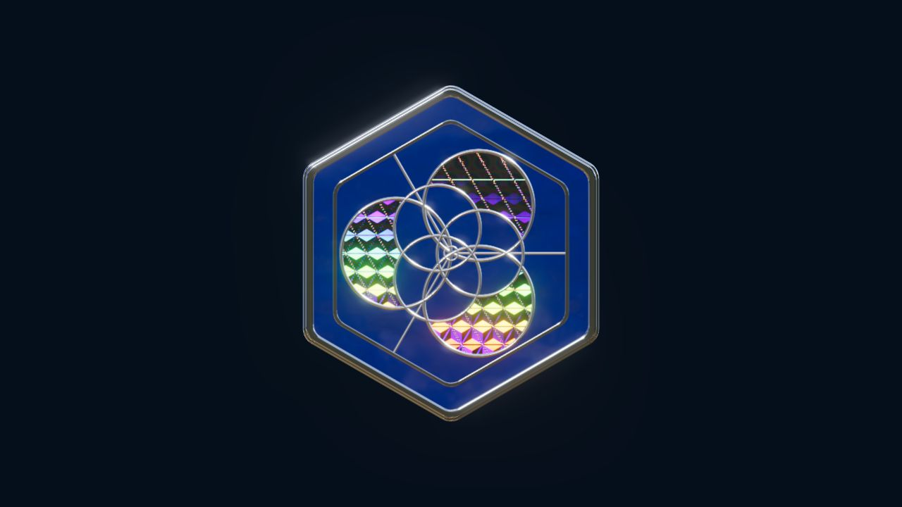

# design-pipeline

> 在 Agent 里说一句要做什么，拿回一份有设计依据、经过实际检查、由你最后点头的作品。


Claude Code：

```text
/plugin marketplace add 2233admin/design-pipeline
/plugin install design-pipeline@design-pipeline
```

Codex 和其他 agent：

```bash
SKILLS_DOWNLOAD_MAX_BYTES=104857600 SKILLS_EXTRACT_MAX_BYTES=268435456 SKILLS_EXTRACT_MAX_FILES=5000 \
  npx skills add https://github.com/2233admin/design-pipeline/releases/latest/download/design-pipeline-skill.zip \
  --skill design-pipeline -a codex -g
```

然后让你的 agent 运行 `designer-pipeline doctor`：它列出缺什么、每项给一条可复制的命令，不会替你安装任何东西。装好以后直接说需求，例如“用 design-pipeline 给这个项目做一个设置页”。Windows、离线 Release 包和升级方式见 [安装与第一次运行](docs/install.md)。需要 Node.js 22.12 或更新版本。

[能做什么](#能做什么) · [怎么工作](#怎么工作) · [作品案例](#作品案例珐琅徽章) · [原则](#几条原则) · [文档](#继续阅读)

---

## 能做什么

| 你要做的 | 拿到的交付物 | 检查方式 |
| --- | --- | --- |
| 一个页面或一套界面 | 可运行的页面，加上项目的 `DESIGN.md` 与 `MOTION.md` | 浏览器里实测字号、对比度、溢出、交互；再给你看真实页面 |
| 复刻或参考一个网站 | 按参考实现的页面和逐视口的保真报告 | 每个声明的视口、每条参考映射单独比较 |
| 一套设计系统 | `DESIGN.md` 和 design-system 包：带用法说明的 token、组件指南与实时预览 | 包结构与 token 来源一致性检查 |
| 动效网站或产品宣传片 | 分镜、时间线和可播放的成片 | 逐秒审帧、构图、音频与配乐检查 |
| PV / MAD 剪辑 | 按节拍切点的剪辑 | 节奏与切点检查，实际播放画面与声音 |
| 一个局部小任务 | 绘图、排版、构图、Canvas study 等单项产出 | 沿用你项目现有的流程与检查 |
| 设计评审 | 带编号问题和修复建议的评审 | 能量的量出来，量不出来的走复查清单 |

完整说明与命令见 [功能详解](docs/features.md)。

## 怎么工作

完整交付从 `designer-pipeline next` 开始。它每次只给 Agent 一个动作：去做、问你一个问题，或报告完成证据。按任务大小分三档：

- **quick**：一个动效、一个镜头、一个组件或一处修复。
- **standard**：一个完整交付物，带简报、方向和草稿几个决定点。
- **full**：在 standard 之上加完整计划、证据流程和 OpenSpec 变更。

一次完整交付大致是这样：

1. **定目标**：交付物、参考、使用场景和验收条件。
2. **选方向**：开放式设计先出几个同内容、同视口的候选给你看真稿，再选。
3. **写依据**：把选定的方向落进 `DESIGN.md`（视觉系统）和 `MOTION.md`（动效语言）。
4. **实现**：按需读取方法、选择工具，小步完成。
5. **实际检查**：在浏览器里看画面和交互，影片和剪辑实际播放；不合格就修，修完重跑。
6. **你来验收**：展示真实作品，由你接受或拒绝。你说过的“不”会记成规则，下次不再犯。

局部任务不走这条线，直接从 [工具索引](skill/tools/README.md) 选一个工具。

## 作品案例：珐琅徽章



[在线体验](https://2233admin.github.io/design-pipeline/enamel-badge/) · [源码与运行说明](examples/enamel-badge/)

蓝釉、银色掐丝、虹彩箔片与凸透镜的交互材质研究，由 Agent 与用户多轮校对完成，不是一次自动复刻的结果；玻璃效果与参考仍有误差。[制作边界与依赖来源](examples/enamel-badge/README.md)见案例说明。更多案例在 [`examples/`](examples/)。

## 几条原则

- **先设计，再写代码。** Agent 动手前要有明确依据，改动后要有能检查的结果。
- **检查不等于验收。** 门禁只报告技术符合性（Component Conformance）；画面好不好、方向对不对，由你看真实作品后决定（Visual Acceptance）。每一档的最终验收都是你的。
- **只量事实。** 自动检查只拦量得出来的问题，例如图裂、字太小、对比度不足、溢出、控制台报错；审美判断留给人。
- **工具不等于已安装。** 管线负责选择、探测和验收；目标项目自己固定并安装实际运行时。
- **记录来源和许可。** 非商用素材不进商用作品。

## 适合谁

- 用 Agent 做前端 UI，希望样式、组件状态和后续修改有共同依据。
- 复刻网站或研究视觉参考，需要核对真实来源、画面和交互差异。
- 做动效网站、产品宣传片或 PV/MAD，需要把构图、时间线、声音和播放检查串起来。

不适合只想要一次性快速原型、不愿意留下任何设计文档的场景。

## 继续阅读

- [安装与第一次运行](docs/install.md)：Claude Code 插件、Codex 等 agent、`doctor`、离线 Release 包、第一个设计基础。
- [功能详解](docs/features.md)：每项能力的说明与命令。
- [Agent 入口 `skill/SKILL.md`](skill/SKILL.md)：Agent 读到的路由表。
- [维护者指南](docs/maintainers.md)：OpenSpec、仓库布局、维护命令与发布标准；贡献流程见 [`.github/CONTRIBUTING.md`](.github/CONTRIBUTING.md)。
- [文档索引](docs/README.md)、[术语表](docs/GLOSSARY.md)、[更新日志](CHANGELOG.md)。

## 同生态项目

- [repowise](https://github.com/2233admin/repowise)：AI Agent 的代码库智能层
- [performance-patterns-skill](https://github.com/2233admin/performance-patterns-skill)：性能问题先路由再排查
- [markdown-memory](https://github.com/2233admin/markdown-memory)：文件驱动的 AI 记忆桥
- [gc-minimal-zine-poster](https://github.com/LiamGvchi/gc-minimal-zine-poster)：极简 zine 海报生成与参考分析 Skill
- [gc-still-image-motion-director](https://github.com/LiamGvchi/gc-still-image-motion-director)：静态图片动效判断与 Prompt 约束 Skill

## License

MIT
