<div align="center">

# design-pipeline

> 在 Agent 里说一句要做什么，拿回一份有设计依据、经过实际检查、由你最后点头的作品。


</div>

页面、界面、设计系统、动效网站、产品片和 PV 剪辑都走同一条线：先定方向，再写依据，做完在浏览器里量，最后由你看真东西验收。

这一版补上了做平面和游戏美术时最缺的几样：**模板库和风格包**、**从参考图蒸馏出风格包草稿**、**按实际字形覆盖选开源字体**、**从公有领域馆藏取图、切图并自己生成纸纹和网点**，每一件素材都记出处。下面前六个游戏案例用的就是这些命令。

Claude Code：

```text
/plugin marketplace add 2233admin/design-pipeline
/plugin install design-pipeline@design-pipeline
```

Codex 和其他 agent：

```bash
SKILLS_DOWNLOAD_MAX_BYTES=104857600 SKILLS_EXTRACT_MAX_BYTES=268435456 SKILLS_EXTRACT_MAX_FILES=5000 \
  npx skills add https://github.com/2233admin/design-pipeline/releases/latest/download/design-pipeline-skill.zip \
  --skill design-pipeline -a codex -g
```

然后让你的 agent 运行 `designer-pipeline doctor`：它列出缺什么、每项给一条可复制的命令，不会替你安装任何东西。装好以后直接说需求，例如“用 design-pipeline 给这个卡牌游戏做一套卡面模板”。Windows、离线 Release 包和升级方式见 [安装与第一次运行](docs/install.md)。需要 Node.js 22.12 或更新版本。

[案例](#案例) · [检查零问题不等于好](#为什么检查零问题不等于好) · [能做什么](#能做什么) · [怎么工作](#怎么工作) · [原则](#几条原则) · [局限](#局限) · [文档](#继续阅读)

---

<p align="center">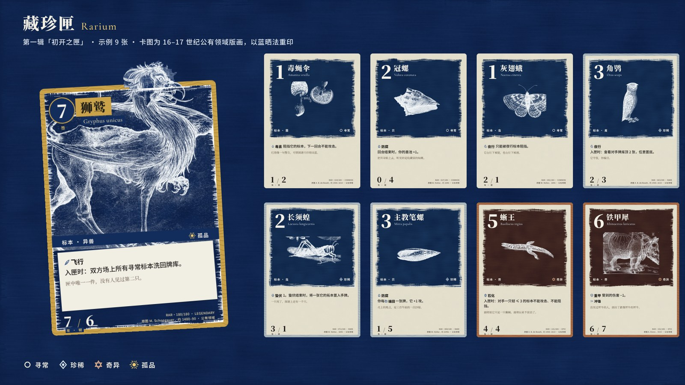</p>
<p align="center"><sub>▲ 集换卡《藏珍匣》的九张示例卡。卡图是 15–17 世纪的公有领域版画，统一处理成蓝晒白线。</sub></p>

---

## 案例

前六个案例都只给了一句需求。Agent 先出六张缩略稿，挑三个方向做成真稿，再定一个做完整套；每一件成品都跑过 `template check --browser`，问题数按「第一轮直出」和「最终」分开记。其中五个做了不止一轮：第一轮检查基本通过，却被人工评审判为平庸，或者在 64px 缩略测试里和通用套件分不开，于是整套重做（见[为什么检查零问题不等于好](#为什么检查零问题不等于好)）。最后一个《夜想回廊》是更早的一次实验，它的版式后来成了模板库里的一个风格包。

这些案例没有用 AI 生图：插图来自博物馆的 CC0 / 公有领域馆藏，其余是代码画的。每个案例最后一句是它的局限，照实写。

### 游戏 UI · 《藏珍匣 RARIUM》集换式卡牌

> 「给一款集换式卡牌游戏做卡面模板（四种稀有度）、一套 9 张示例卡、卡包开启界面和 6 秒开包动效」

六张缩略稿里选了最冒险的「蓝晒印相」，借的是 Anna Atkins 1843 年蓝晒藻类图谱的工艺：手刷药液的毛边，整套只用一种普鲁士蓝，标本是蓝底上的白影。卡图是 Dürer、Hollar、Schongauer、de Boodt 的版画，先取出墨色密度，再统一重印成蓝晒白线。稀有度不靠换底色，靠换工序：寻常是纸边，珍稀加银箔框，奇异用单宁把蓝调成紫褐、配铜箔，孤品是满版深蓝加金箔，狮鹫的头冲出卡牌上缘。

<p align="center">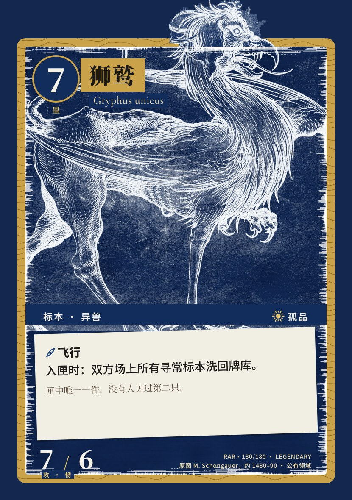</p>
<p align="center">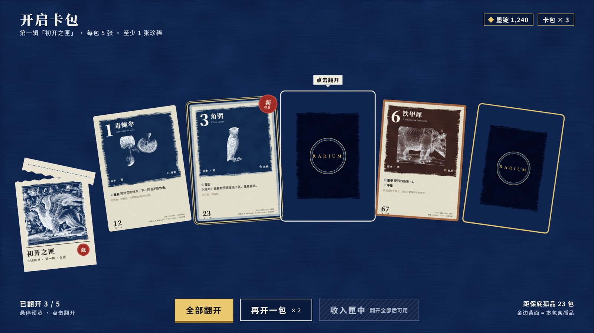</p>
<p align="center">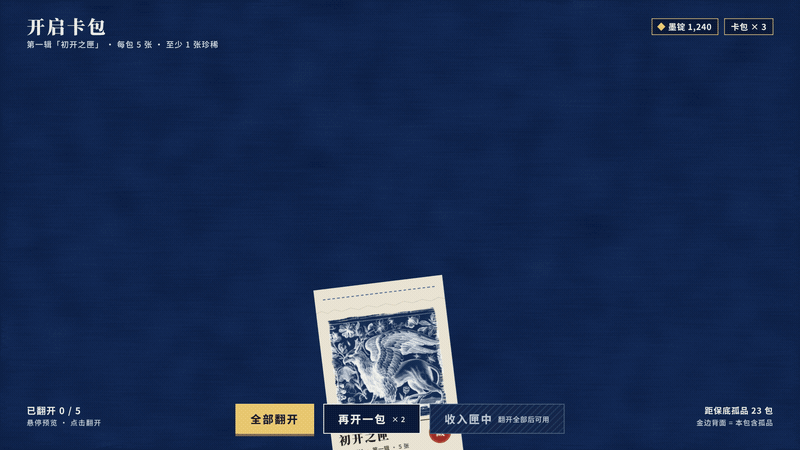</p>

**做法**：`materials search` / `fetch` 从大都会、克利夫兰、Rijksmuseum 取 10 件 CC0 / PDM 版画，`materials cut --finish ink` 取墨色密度，`materials check` 核对 20 条出处记录；`fonts query --style mincho --weight 700` 选出 Noto Serif SC；`template check --browser` 查 9 张单卡、九卡总览、开包界面和 11 个动效关键帧。模板库里没有集换卡模板，卡框是手写的。

**检查**：第一轮单卡 10–21 处、总览 170 处（大部分是纸纹没用 multiply 叠加，被算成压字的拼贴）、开包界面 76 处，最终都是 0。动效 3.5 秒那一帧还剩 1 处对比度，疑似测量问题，没有查实，记为未解决。

**局限**：箔是平面的扭索纹线，没有真实烫金的光泽，动效里只能靠一条扫过的亮带暗示。de Boodt 的原作是彩色水彩，蓝晒之后红色的毒蝇伞也只剩蓝白，这是为了整套统一付出的代价。

### 直播包装 · 北线联赛总决赛

> 「给一场原创电竞联赛做直播包装：比分条、选手卡、BP（禁选）界面、赛程海报和 8 秒开场」

第一版用地铁线路图画淘汰赛，工整，但是电竞包装的老套路。重做时用的是 70–80 年代朋克复印传单的语法：只有一种荧光粉油墨，标题是一字一块的剪报勒索字，战队代码和比分是代码画的喷漆模板字。赛程海报做成乐队巡演传单，BP 界面里被禁的角色直接喷一个叉。复印底来自 George Bellows 1909 年的拳赛油画。比分条压在代码画的对局画面上试过，手机小窗的版本是重新排版，不是整体缩小，最小字 11px。

<p align="center">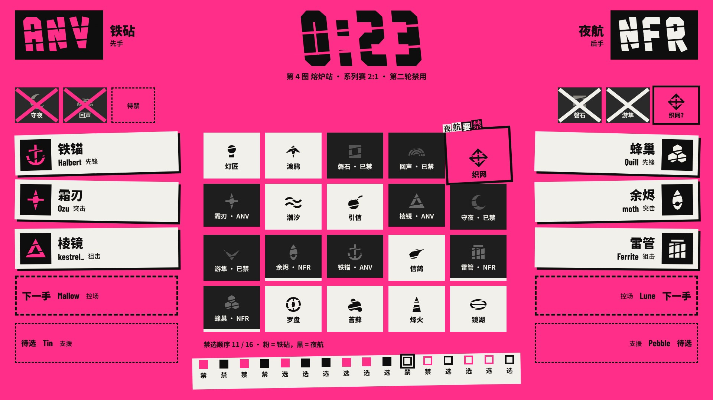</p>
<p align="center">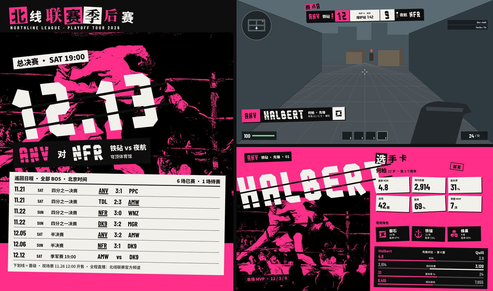</p>
<p align="center">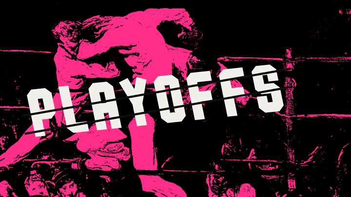</p>

**做法**：`materials search` / `fetch --source cleveland` / `cut --finish ink` 取 Bellows 的画，再二值化成复印颗粒，`materials check` 核对出处；`fonts query` 选 Noto Sans SC / Noto Serif SC；模板字用模板库的代码字形 `lettering.cjs`；每张成品跑 `template check --browser`。

**检查**：第一轮工具报 13 处、目测 10 处，最终 0。开场有两拍只有模板字，模板字是路径，工具量不到，这两拍的可读性是目测的。

**局限**：对局画面只是示意，不是真游戏画面；角色图标沿用第一版的几何形，只加了模板桥；荧光粉在不同屏幕和压缩下颜色会跑，直播前要在推流链路上实测。

### 游戏宣发 · 《远灯 FARLAMP》Steam 商店全套图

> 「给一款独立游戏做 Steam 商店的全套图和商店页首屏」

先按 Steamworks 文档逐项核对尺寸：13 张素材，12 种尺寸。第一轮是藏青夜空配琥珀色的光，检查全部通过，但被评为太平庸。第二轮改用 Cassandre 式石印海报的语法：朱红占满画面，仰视的灯塔大到冲出画框，光是一块没上色的纸白，末端被网点吃掉，墨版故意错开一点，露出一道暗红套印。标题「远灯」顺着光的角度斜放，被三道光缝切开。每个尺寸都单独排版：小型图缩到商店列表的 120×45 时，标题框还有 24px 高，OCR 能读出中英两个名字；直接裁页眉的对照版只有 15px，读不出英文。

<p align="center">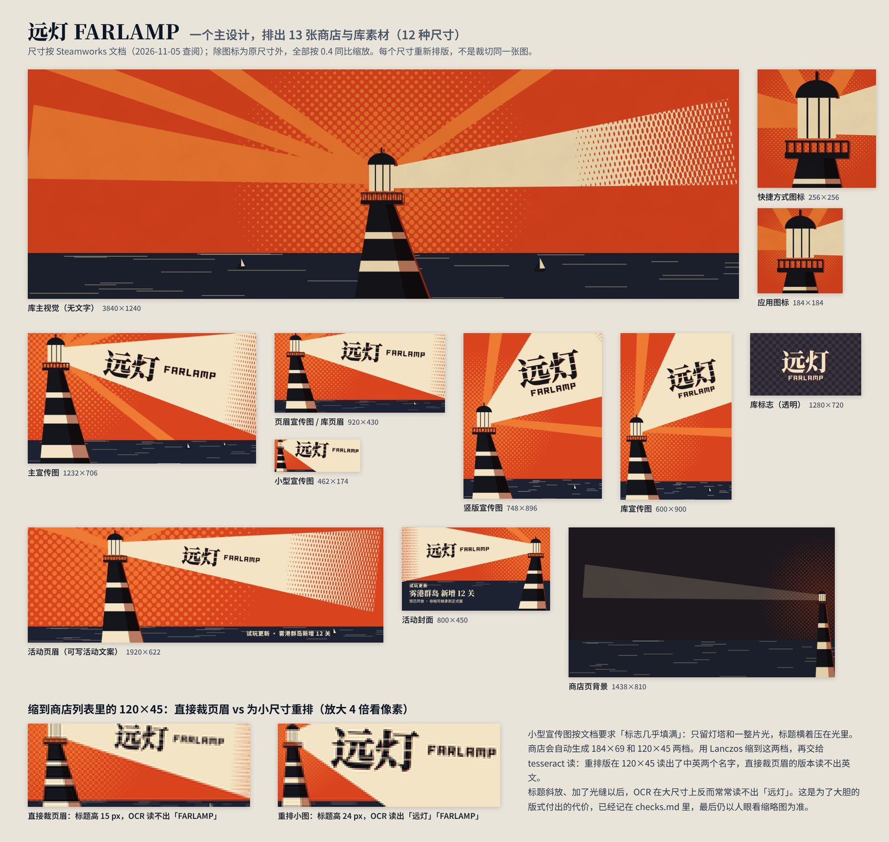</p>
<p align="center">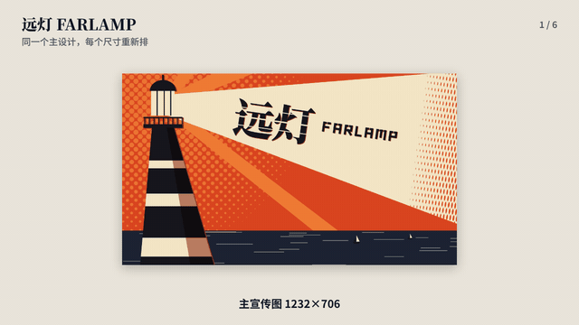</p>
<p align="center">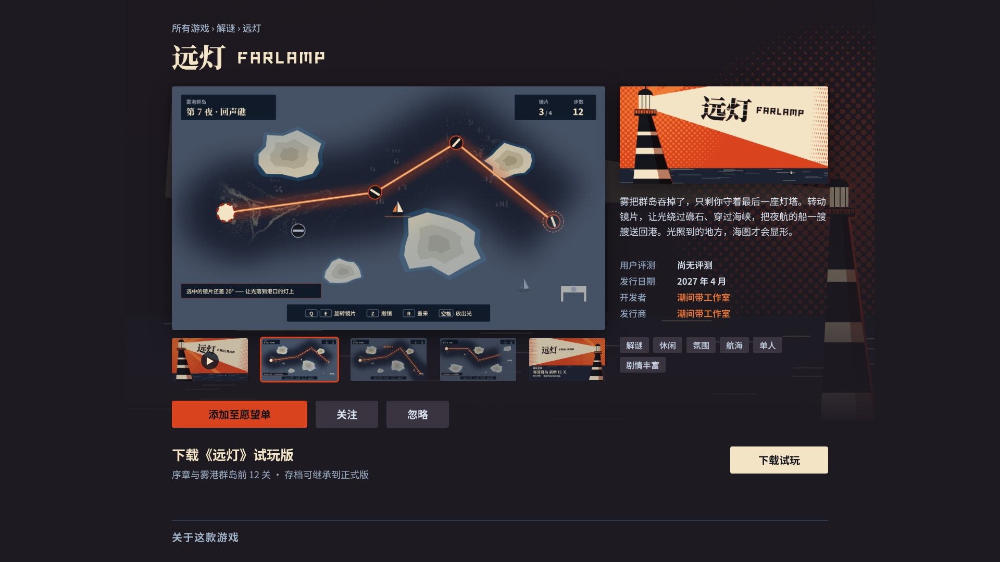</p>

**做法**：`fonts query --weight 900` 选出 Noto Serif SC；`materials search` / `fetch --source met` / `cut` 取 1854 年的美国海岸测量图（只留在游戏画面里）；`materials add` 登记 5 张自制的纸纹和网点；英文字标用 `lettering.cjs` 画成镂空宽体；`template check --browser --size WxH` 逐个尺寸查；可读性用 tesseract 在商店缩放后的尺寸上读。

**检查**：第二轮直出 3 处，最终剩 1 处：库标志是透明 PNG，单独检查时底下是白色；放到实际位置（库主视觉左下角）是 3.88:1，按大字算通过。

**局限**：斜放加切口的标题让 OCR 在大尺寸上大多读不出「远灯」（11 档里只读出 2 档），人眼没有问题，这是这个方向的代价，没有为了 OCR 把标题放平。3 张游戏截图只是界面示意，比宣传图平淡；Steam 要求截图必须是实际游戏画面，而且至少 5 张。

### 游戏活动 · 《白昼公馆》夏日活动「三点钟的泳池」

> 「给一款二次元手游做一次限时活动的全套：横版 KV、活动主界面、招募（抽卡）界面和十连结果、10 秒招募动效」

第一版是海军蓝配黄铜的海图灯塔，干净但平庸。重做时用的是 80 年代日本城市流行唱片封套的语法（永井博、铃木英人）：平涂的空泳池、白墙、硬投影、下午三点的太阳。主色只有泳池青，柠檬黄只给 6★ 和主按钮。招牌元素是自己画的三线数字「15:00」。8 个关卡就是 8 条泳道，限定池是一张唱片封套，十连结果是一墙明信片。

<p align="center">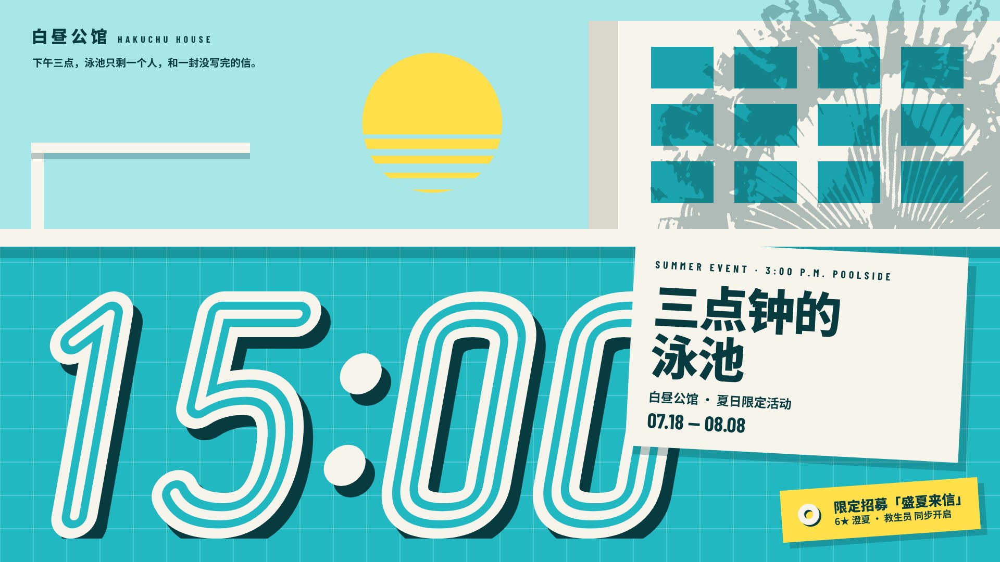</p>
<p align="center">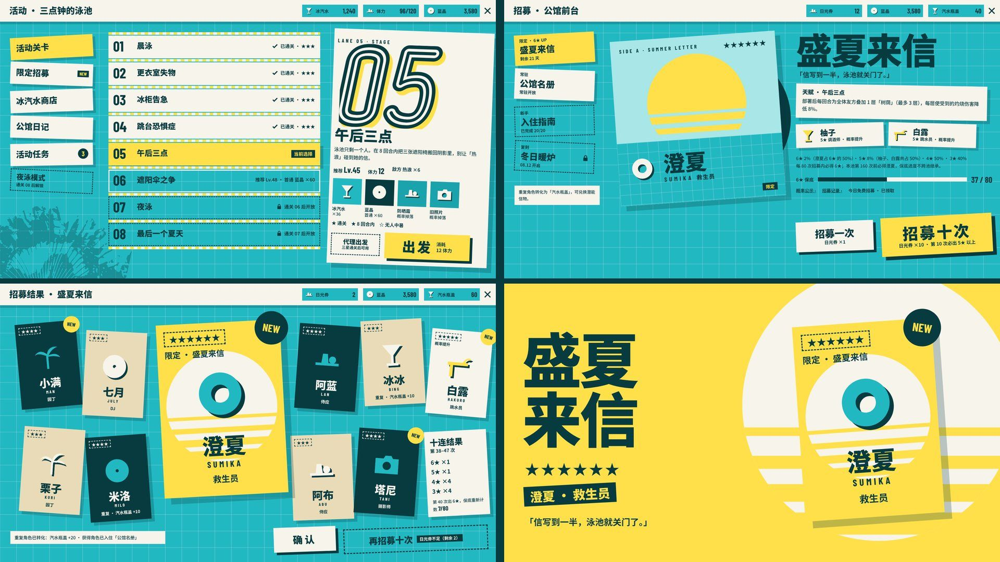</p>
<p align="center">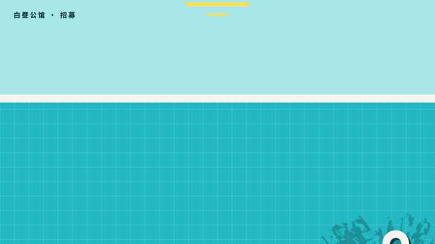</p>

第一版（海图灯塔）的 KV，检查同样是 0 处问题：

<p align="center">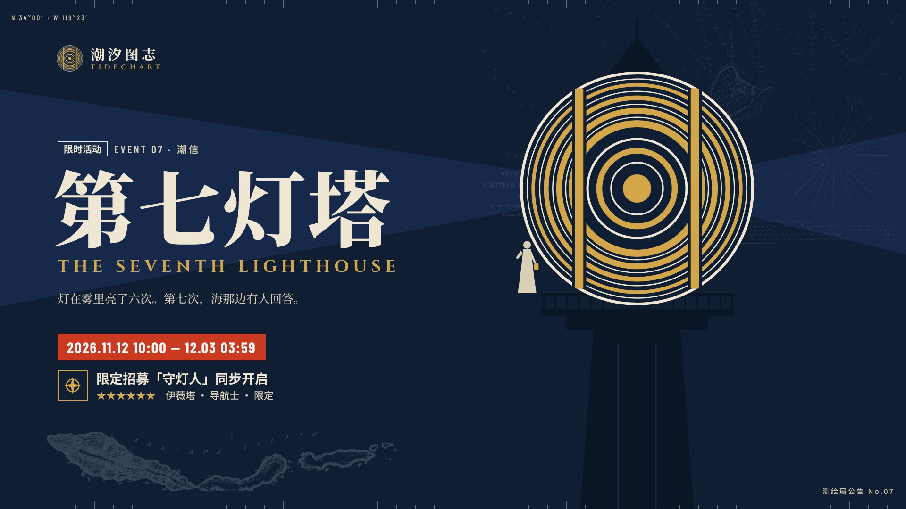</p>

**做法**：`materials search` / `fetch --source met` / `cut --finish ink` 把大都会一张 1860 年代的棕榈照片做成剪影投影，`materials check` 核对出处；`fonts query --style gothic` 选 Noto Sans SC；三线数字是自己画的路径；`template check --browser` 查每张成品和动效的 6 个状态。

**检查**：第一轮工具报 17 处（其中 12 处是十连 4★ 卡的深青底只有 4.03:1）、目测 10 处，最终 0。

**局限**：没有立绘，角色只靠泳池用品图标、名字和稀有度底色区分；横纹太阳加棕榈离蒸汽波的套路不远，靠三线数字和泳道结构才拉开；动效没有音效，也没做跳过。

### 游戏 HUD · 《零点潮汐 NULLTIDE》战术射击

> 「给一款科幻战术射击游戏做战斗 HUD：血量护盾、弹药、小地图、技能栏、击杀提示，以及受击与击杀的 6 秒动效」

第一轮选了最稳的「军规单色」，缩到 64px 就和任何 HUD 套件分不开，于是换成六张缩略稿里最大胆的「酸性印刷」，借的是 Bungie《Marathon》的图形写实语法和瑞士海报的极端字阶。代码画的港口场景印成冷灰网点，整屏只留一种酸绿。血量和弹药是 168px 的切角数字，弹药数字带一层错版的橙红，低弹时两色对调。击杀提示是一张斜贴的贴纸。

<p align="center">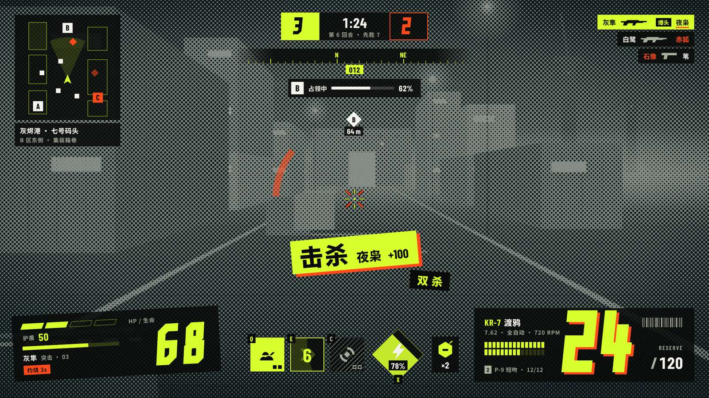</p>
<p align="center">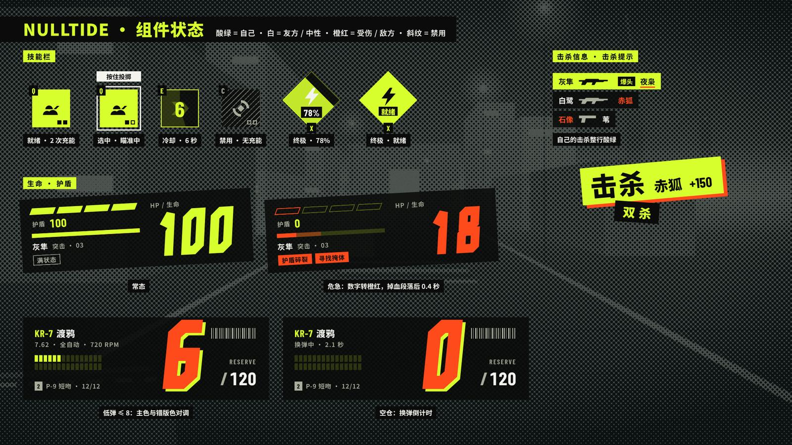</p>
<p align="center">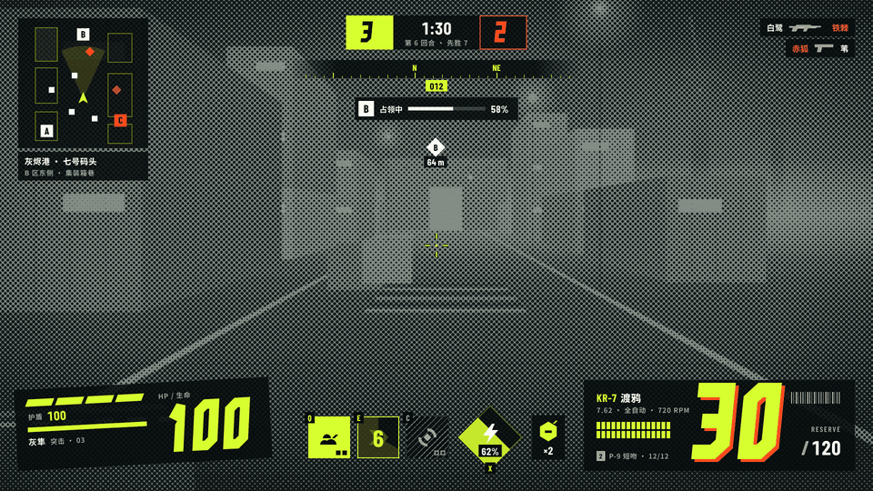</p>

**做法**：`fonts query --text-file <文案> --style gothic --weight 700` 选 Noto Sans SC；大数字用 `lettering.cjs` 的字形，8 是自己用两个 O 环重组的；`template check --browser --size 1920x1080` 查静帧、状态表和 9 个动效关键帧；没有外部图片。

**检查**：第二轮直出静帧 3 处、状态表 5 处、动效 1 处，另有 4 处是人眼发现、检查器看不见的（大数字是路径，比如「8」读成「H」），最终都是 0。

**局限**：场景是代码画的低多边形港口，近看就是一组色块；网点让它退成背景，但这套 HUD 还没在真实 3D 画面上验证过可读性。

### 像素 RPG · 《白垩驿路 CHALKROAD》

> 「给一款像素风 RPG 做标题画面、主菜单、对话框、物品栏和存档界面」

第一轮是深紫底配粉笔白框，检查全过，但缩到 64px 和任何像素 UI 包都分不开。第二轮改用江户驿站木版画的语法，因为游戏讲的就是一条驿路：晕染的天空用 4×4 有序抖动一层层排出来，山的墨线故意偏 1px，每块纸面板后面垫一块偏 2px 的暗红套版。书名是竖排的朱红题签，选中标记是一枚 7×7 的印章。所有画面都在 480×270 上画，只用 16 色，整数放大 4 倍。

<p align="center">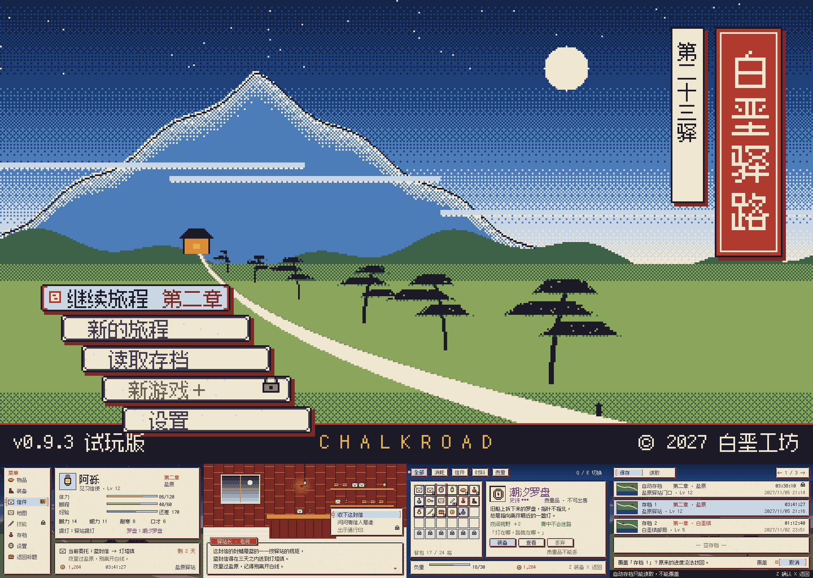</p>
<p align="center">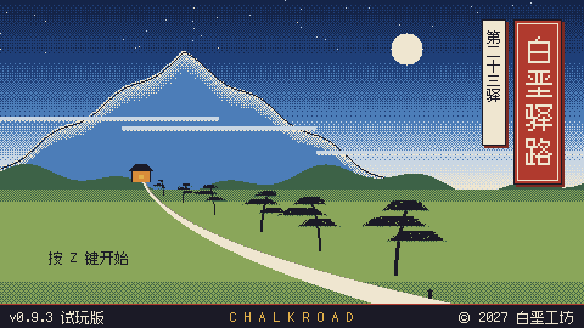</p>

**做法**：`fonts measure --path` 量 Fusion Pixel（OFL）的覆盖：通用规范汉字表前 3500 字全覆盖；字体目录里没有像素字体，所以从 npm 取。`template check --browser --size 480x270` 在原生分辨率上查；另用脚本逐块验证：放大后每个 4×4 块只有一种颜色，没有一个像素在调色板之外。

**检查**：第二轮直出 11 处，全是对比度（例如金色字压纸只有 1.6:1），最终 0，文字最低 4.76:1。

**局限**：标题画面和物品栏立住了，主菜单、对话、存档只是换了皮，布局还是普通的方框，64px 下仍然像通用界面。JPG 压缩后像素边缘有一点糊。

### 动画宣发与游戏 UI · 《夜想回廊 NOCTURNE CORRIDOR》

> 「为一部原创动画做一套新房风格的平面和 UI：主视觉、字幕卡、官网两屏、道具图鉴和一段字幕卡快切」

新房（SHAFT）式的平面本质上是字体和版式，不靠角色，所以这一单不画人：满屏一种底色的字幕卡，高对比明朝体对撞小号黑体，红黑白平涂，对称的透视走廊和棋盘地面，剪纸拼贴。拼贴物件是克利夫兰和大都会的 CC0 版画与器物（Piranesi 的楼梯、Redouté 的花、钥匙、怀表机芯）和 Haeckel 的图版。日文明朝体缺「钥」「证」「记」这类简体字，所以按整串切到 Noto Serif CJK SC，不逐字回退。快切片 13.1 秒，闪切 2–6 帧，定格之间夹黑场。

<p align="center">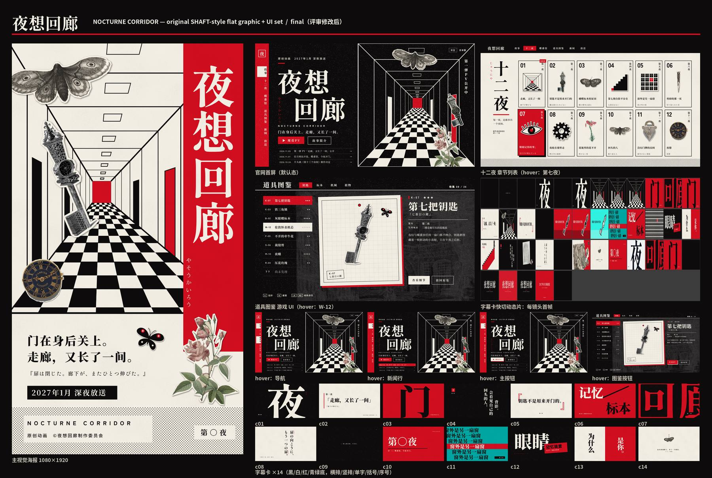</p>
<p align="center">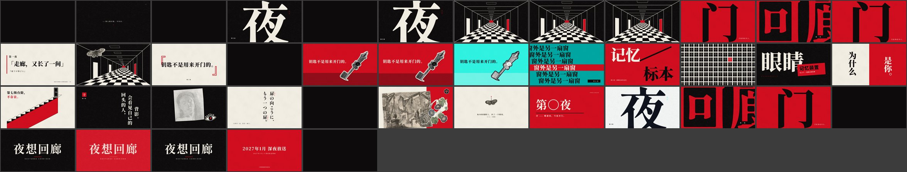</p>

**做法**：这一单早于素材和字体命令，检查用的是当时自写的脚本（墨迹框重叠、出画、拼贴压字、隐藏文字后取第 10 百分位算对比度、字形覆盖）。它的版式后来收进模板库，成了 `shinbo` 风格包（11 个模板，包括 7 种字幕卡和快切节奏表 `motion.title-card-cut`）；字体目录和程序化纸纹的实测也拿它做过对照。

**检查**：第一轮对比度 13 处、出画 1 处、重叠 3 处、压字 2 处；最终对比度和出画都是 0，仍有 3 处重叠（三张超大单字卡上，小字压着大字的边框）和 1 处压字（片中一帧的字被钥匙图盖住 12%）。快切片不做成动图，因为闪切在 GIF 里会丢帧，也不适合在页面上自动播放；上面是每个镜头的首帧。

**局限**：没有角色，这是有意的取舍。上面的问题数是当时的自写脚本量的，不是用现在发布的 `template check` 重跑的结果。

### 交互材质 · 珐琅徽章

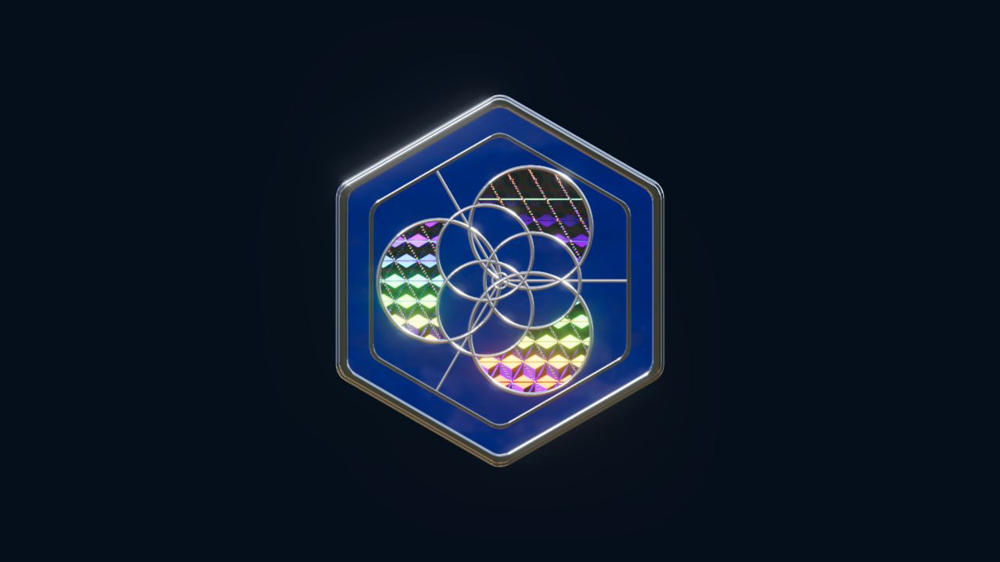

[在线体验](https://2233admin.github.io/design-pipeline/enamel-badge/) · [源码与运行说明](examples/enamel-badge/)

蓝釉、银色掐丝、虹彩箔片与凸透镜的交互材质研究，由 Agent 与用户多轮校对完成，不是一次自动复刻的结果；玻璃效果与参考仍有误差。[制作边界与依赖来源](examples/enamel-badge/README.md)见案例说明。更多案例在 [`examples/`](examples/)。

## 为什么检查零问题不等于好

检查只量量得出来的事：字压没压、出没出画、对比度够不够、有没有缺字。它不知道一个画面是不是平庸。上面电竞、抽卡、HUD、像素四个案例的第一版，最终检查都是 0 处问题：电竞和抽卡被人工评审判为平庸，HUD 和像素在 64px 下和通用套件分不开，四个都整套重做了。Steam 第一轮只剩库标志透明底的 2 处，也被评为太平庸。

<table>
<tr>
<td width="50%">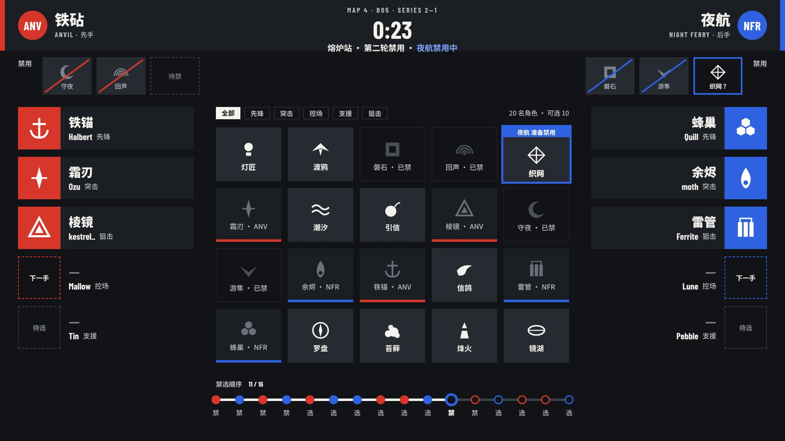</td>
<td width="50%"></td>
</tr>
<tr>
<td>第一版：最终 0 处问题。64px 下和通用深色界面套件的差只有 <b>20.1</b>。</td>
<td>第二版：最终 0 处问题。64px 下的差是 <b>106.4</b>，粉色占画面 73%。</td>
</tr>
</table>

所以每个案例另做了一个 **64px 缩略测试**：遮掉 logo，把成品缩到 64px，和一张自己搭的「通用深色 UI 套件」对照页比像素差。抽卡第一版的四张图和对照页只差 18–20，第三版差 118–141。这个数字也有盲区：其中一部分只是亮底对暗底，所以每次还要人眼看缩略图能不能认出来。

这个测试说明的是「认得出、不撞脸」，不说明好看。好不好看，还是由你看真东西决定。

## 能做什么

| 你要做的 | 拿到的交付物 | 检查方式 |
| --- | --- | --- |
| 一个页面或一套界面 | 可运行的页面，加上项目的 `DESIGN.md` 与 `MOTION.md` | 浏览器里实测字号、对比度、溢出、交互；再给你看真实页面 |
| 游戏界面与宣发图 | 卡牌、HUD、活动与抽卡界面、直播包装、商店素材，带状态和动效 | `template check --browser` 逐张查重叠、出画、压字、对比度、遮挡、缺字 |
| 按模板出图 | 从模板库按 id 渲染 KV、封面、卡片、横幅、UI 面板和字幕卡快切 | 渲染时就检查：文字是否放得下、字数与行数预算、最小字号、对比度、主体区与裁切区 |
| 把参考图变成风格 | 风格包草稿 `style.json`、版式原型和一页报告 | 每条规则来自参考的实测分布，证据不足的标为缺口 |
| 选字体 | 覆盖全部文案的开源字体候选，带许可和字重 | 按字体文件的实际字形表核对，缺哪个字列出来 |
| 找素材、做素材 | 公有领域图片、切好的贴纸与墨层、自己生成的纸纹和网点 | 每个文件都有出处和许可记录，来源变了会报出来 |
| 复刻或参考一个网站 | 按参考实现的页面和逐视口的保真报告 | 每个声明的视口、每条参考映射单独比较 |
| 一套设计系统 | `DESIGN.md` 和 design-system 包：带用法说明的 token、组件指南与实时预览 | 包结构与 token 来源一致性检查 |
| 动效网站或产品宣传片 | 分镜、时间线和可播放的成片 | 逐秒审帧、构图、音频与配乐检查 |
| PV / MAD 剪辑 | 按节拍切点的剪辑 | 节奏与切点检查，实际播放画面与声音 |
| 设计评审 | 带编号问题和修复建议的评审 | 能量的量出来，量不出来的走复查清单 |

完整说明与命令见 [功能详解](docs/features.md)。

## 怎么工作

完整交付从 `designer-pipeline next` 开始。它每次只给 Agent 一个动作：去做、问你一个问题，或报告完成证据。按任务大小分三档：

- **quick**：一个动效、一个镜头、一个组件或一处修复。
- **standard**：一个完整交付物，带简报、方向和草稿几个决定点。
- **full**：在 standard 之上加完整计划、证据流程和 OpenSpec 变更。

一次完整交付大致是这样：

1. **定目标**：交付物、参考、使用场景和验收条件。
2. **选方向**：开放式设计先出几个同内容、同视口的候选给你看真稿，再选。
3. **写依据**：把选定的方向落进 `DESIGN.md`（视觉系统）和 `MOTION.md`（动效语言）。
4. **实现**：按需读取方法、选择工具，小步完成。
5. **实际检查**：在浏览器里看画面和交互，影片和剪辑实际播放；不合格就修，修完重跑。
6. **你来验收**：展示真实作品，由你接受或拒绝。你说过的“不”会记成规则，下次不再犯。

局部任务不走这条线，直接从 [工具索引](skill/tools/README.md) 选一个工具。

### 做平面和游戏美术时用到的四样

- **模板库与风格包**：`template list` / `render` / `check`。模板是带参数的 SVG 版式，每个槽位有字数和行数预算；风格包把字体角色、版式语法、素材、动效节奏和检查规则放在一起。现在有两个风格包、20 个模板，其中 `shinbo` 来自上面的《夜想回廊》。案例里的卡牌、HUD 和 Steam 图没有现成模板，版式是手写的，用的是同一个浏览器检查。
- **参考蒸馏**：`template distill` 读一组参考图（只读本地文件，不复制），量出配色、留白、重心、对称、纹理等特征（给了标注时还量标题位置、边距和字号比），用参考的分布定阈值，写出风格包草稿和一页报告，证据不够的规则标为缺口。
- **字体目录**：`fonts query --text-file <文案>` 只返回字形表覆盖全部文案的字体，差几个字的列出缺哪几个。目录收了 98 个中日文开源字体家族，每个都带许可、字重和笔画对比；`fonts measure --path` 量你自己的字体文件。
- **素材来源与自制素材**：`materials search` / `fetch` 只下载 CC0 和公有领域的馆藏图（克利夫兰、大都会、Rijksmuseum 可自动取，Wikimedia 按文件名取），`cut` 切成贴纸、墨层和版画块，`generate` / `process` 用固定种子生成纸纹、网点、油墨和建筑线稿，`check` 核对每个文件的出处和许可。

## 几条原则

- **先设计，再写代码。** Agent 动手前要有明确依据，改动后要有能检查的结果。
- **检查不等于验收。** 门禁只报告技术符合性（Component Conformance）；画面好不好、方向对不对，由你看真实作品后决定（Visual Acceptance）。每一档的最终验收都是你的。
- **只量事实。** 自动检查只拦量得出来的问题，例如图裂、字太小、对比度不足、溢出、缺字、控制台报错；审美判断留给人。
- **工具不等于已安装。** 管线负责选择、探测和验收；目标项目自己固定并安装实际运行时。
- **记录来源和许可。** 每件素材记出处；非商用素材不进商用作品。

## 局限

- **不生成插画和角色。** 案例里的图来自公有领域馆藏或代码绘制，没有立绘；需要角色时，要你提供或另配工具。
- **代码画的字量不到。** 模板字、切角数字这类 SVG 路径，浏览器检查读不到它们的对比度和重叠，只能按色值另算，加上人眼看。
- **示意画面不是真游戏画面。** HUD、比分条和 Steam 截图都压在代码画的示意场景上，放进真实画面前要重新验证。
- **模板库还小。** 两个风格包、20 个模板，没有卡牌、HUD 和商店图模板。
- **检查过了也可能平庸。** 见[上一节](#为什么检查零问题不等于好)，方向好不好要你来判断。

## 适合谁

- 用 Agent 做前端 UI 或游戏界面，希望样式、组件状态和后续修改有共同依据。
- 做海报、宣发图、卡面这类平面，需要有出处的素材、覆盖全部文案的字体和逐张检查。
- 复刻网站或研究视觉参考，需要核对真实来源、画面和交互差异。
- 做动效网站、产品宣传片或 PV/MAD，需要把构图、时间线、声音和播放检查串起来。

不适合只想要一次性快速原型、不愿意留下任何设计文档的场景。

## 继续阅读

- [安装与第一次运行](docs/install.md)：Claude Code 插件、Codex 等 agent、`doctor`、离线 Release 包、第一个设计基础。
- [功能详解](docs/features.md)：每项能力的说明与命令。
- [Agent 入口 `skill/SKILL.md`](skill/SKILL.md)：Agent 读到的路由表。
- [模板库指南](skill/references/template-bank.md)：模板、风格包、`template check` 与 `template distill`。
- [维护者指南](docs/maintainers.md)：OpenSpec、仓库布局、维护命令与发布标准；贡献流程见 [`.github/CONTRIBUTING.md`](.github/CONTRIBUTING.md)。
- [文档索引](docs/README.md)、[术语表](docs/GLOSSARY.md)、[更新日志](CHANGELOG.md)。

## 同生态项目

- [repowise](https://github.com/2233admin/repowise)：AI Agent 的代码库智能层
- [performance-patterns-skill](https://github.com/2233admin/performance-patterns-skill)：性能问题先路由再排查
- [markdown-memory](https://github.com/2233admin/markdown-memory)：文件驱动的 AI 记忆桥
- [gc-minimal-zine-poster](https://github.com/LiamGvchi/gc-minimal-zine-poster)：极简 zine 海报生成与参考分析 Skill
- [gc-still-image-motion-director](https://github.com/LiamGvchi/gc-still-image-motion-director)：静态图片动效判断与 Prompt 约束 Skill

## License

MIT。案例图片里的版画与照片来自 CC0 / 公有领域馆藏，字体均为 SIL OFL 1.1；各案例的出处记录在制作时的 `materials/licenses.json` 中。
