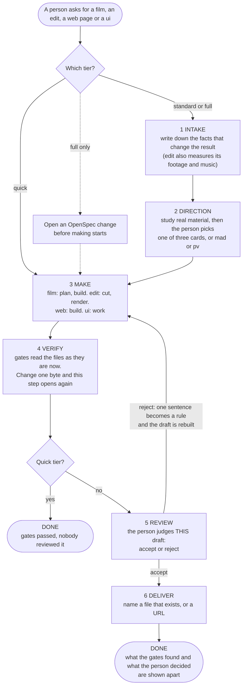

# One lifecycle for film, edit, web and ui (spec, draft)

Status: draft, awaiting approval (2026-09-30). Nothing here is approved. The behaviour change ships as
the OpenSpec change `openspec/changes/align-workflow-lifecycle/`. This document is the summary and
the place to answer the open questions; `design.md` of the change holds the proof for each item.
Nothing is built: no code, test, registration file or changelog line was written.

## Problem

The user has asked several times to "optimise the workflow". The four deliverables do not follow one
shape, and `next` can call a job finished on evidence that is missing or out of date. Each claim below
was read in the code or reproduced by a throwaway script that changed nothing in the repository.

Words used here. A **deliverable** is what is made: `film`, `edit`, `web` or `ui`. A **stage** is one
step of the `next` loop. A **gate** is a check that must pass. A **fingerprint** is a short code worked
out from a file's contents; change one byte and it changes. A **draft** is what a person is asked to
judge. `design.md` section 0 has the full list.

## The target in five lines

1. Every job goes through six steps: intake, direction, make, verify, review, deliver. Each
   deliverable keeps its own stage names; each stage is labelled with one step. No stage is renamed.
2. Quick keeps make and verify and asks nobody. Standard adds the intake reply and two decisions (the
   pick, the verdict). Full adds an OpenSpec change before making starts, for all four deliverables,
   and adds no stage.
3. "Finished" means evidence that exists now: a passed check counts only while the files it read are
   unchanged; a person's verdict counts only for the draft that person saw; delivery names a file that
   exists, or a URL; and `decide` answers only the question being asked.
4. A stage may be skipped only for the quick tier, a reference the user declined, freeform (nothing to
   study) or a deliverable's nature. Replicate forbids skipping the reference at every tier.
5. `ui` gets the same shape as web (reference, concepts, work, probe, review, deliver) on the existing
   `interaction` gate. No router, gate or receipt is added.

## The picture

A person answers the intake questions, and decides at steps 2 and 5. The rest runs behind gates, or is
recorded by the agent (the delivery). Quick jobs start at step 3; an edit still analyses its material
first, and replicate mode studies the reference first. In words:

| Step | film | edit | web | ui |
| --- | --- | --- | --- | --- |
| 1 Intake | `intake` | `intake`, `analyze` | `intake` | `intake` |
| 2 Direction | `reference`, `concepts` | `reference` (replicate only), `style` | `reference`, `concepts` | `reference` (new), `concepts` (new) |
| 3 Make | `plan`, `build` | `cut`, `render` | `build` | `work` |
| 4 Verify | `check` | `check` | `probe` | `probe` (new) |
| 5 Review | `review` | `review` | `review` | `review` (new) |
| 6 Deliver | `deliver` | `deliver` | `deliver` | `deliver` (new) |

## What was checked, and what held

The starting facts were re-checked against the code.

| Starting fact | Result |
| --- | --- |
| Film and edit `full` do not open an OpenSpec change. | True, and worse: their `full` is identical to `standard`, stage ids and text. Web and `ui` `full` do say it. |
| Only four gates feed `next`. | True: `storyboard`, `film`, `edit`, `interaction`. `ui` has none. |
| Gate records are hash-bound. | Not true today. A record is `{status, at}` and is compared with file times. A deleted input counts as fresh. |
| `pipeline-reference.md` has sections on tiers. | It has none. Its "Start Here" step 5 even says OpenSpec before implementation, against "no OpenSpec" in the `next` text at quick and standard. |
| The tool-list change is specified, not built. | True (7 of 54 tasks). This design keeps its rule that the standard, replicate list holds every stage. |
| Web has only the interaction check. | True until `add-web-composition-checks` lands (slice 1). It extends the same `interaction` gate to also check the first screen at three sizes, with no new gate id. Its documents exist; its code does not. |

## What was found

Fifteen defects (proof, with file and line, in `design.md` section 7):

| # | Defect | Fixed by |
| --- | --- | --- |
| D1 | A person's review can be skipped: `decide` takes any stage at any time. | S3 |
| D2 | An accepted review outlives the draft it judged. | S6 |
| D3 | Delivery is a claim: a missing file is accepted; `ui` quick finishes on a bare `deliver`. | S3 |
| D4 | Gate records go by clock, not content. | S5 |
| D5 | A missing input counts as fresh. | S0 |
| D6 | Two rules pick the film draft (`next` and `film check` can look at different renders). | S5 |
| D7 | `ui` has almost no flow: no gate, no concepts, no review, no guide. | S2 |
| D8 | `full` is `standard` for film and edit. | S8 |
| D9 | Replicate is ignored by web quick and by `ui`. | S2, S4 |
| D10 | Freeform does nothing. | S4 |
| D11 | A rejected draft can come back unchanged and be asked about again. | S6 |
| D12 | Art-director mode skips edit's `style` question. | S9 |
| D13 | A gate pass can be recorded nowhere, silently. | S5 |
| D14 | The reference and the `next` text disagree about OpenSpec. | S8 |
| D15 | The web review names a `qa.md` that no step creates. | S8 |

Nine differences stay on purpose (I1 to I9): quick has no intake, concepts, review or deliver (I1); quick
ends at the gate with no delivery record (I2); edit has `style` instead of concepts (I3); edit's
reference exists only in replicate (I4); only film has an early gate (I5); the web and `ui` review speaks
of a page or screen (I6); film's `deliver` renders the final (I7); intake wording differs by deliverable
(I8); and `decide --stage concept` is kept for the stage ids `concepts` and `style` (I9).

## Approach

- **One master list per deliverable.** A tier or a mode may only remove stages from it; it never adds or
  reorders. That keeps the tool-list change satisfied and needs no new stage for ceremony.
- **Fingerprints extend the existing record.** `state.gates.<gate>` gets `inputs` and a verdict gets
  `subject`. Same file, same functions, same schema id. It is not the separate gate receipt of the
  component-first tool. Old records do not count, so a project in flight repeats each gate and its review
  once.
- **Steps are labels.** They are read by the `next` output, one test and the art-director rule. They never
  pick the next stage.
- **Eleven slices, S0 to S10, mostly a chain.** S0 a missing input is never fresh (one small central fix
  for every gate, before the web checks), S1 web page checks (another change), S2 the `ui` flow (its own
  `probe` and `review`), S3 `decide` answers only what `next` asks (a reject of the review is also accepted
  before and after delivery), S4 modes mean one thing, S5 gate records go by content, S6 a verdict is about
  the draft it judged, S7 `done` separates what was checked from what was decided, S8 the full tier means
  one thing plus guide fixes, S9 step labels and the required-steps test, S10 closure. S3 and S4 run side
  by side. S7 and S8 share no file either, but they stay in order; the other slices share files. Section 8
  of `design.md` lists the files each one owns and what `node scripts/qa.cjs` proves for it.
- **Tests.** Slices S0 and S3 to S9 each add one test file (S2 adds cases to an existing one); the integrator adds the manifest lines and runs
  `node scripts/qa.cjs` once per wave. No test reads the words of a guide or an action.

## Not included

Merging `next`/`decide`, `route`/`toolchain`/`execution` and `change`/`status`/`plan`/`run`; a new entry
command; renaming any stage id or `decide` value; a new gate, receipt or schema; wiring `ui` to
`component-first`, `verify components` or `verify motion`; `film check` reading text boxes; who writes
`control.gates`; checking by code that an OpenSpec change exists; the web page checks (slice 1, another
change); evaluations of `next` for edit, web and `ui`; the reorganisation of `pipeline-reference.md`.

## Open questions and defaults

1. Steps as a `step` field in code, or only in the guides? Default: in code (S9), read by three things
   only.
2. Should film and edit at `full` open an OpenSpec change like web and `ui`? Default: yes (S8). The
   alternative is to say `full` equals `standard` for them.
3. Check the ceremony by code (a change id in the state and a new `decide` value)? Default: no; the
   structured `openspec: "required"` field and prose.
4. Are `inputs` and `subject` an extension of workflow-state v1? Default: yes (`design.md` 5.3 and the
   options in 5.7). If not, keep the clock rule after S0: S5 shrinks to the draft rule (D6) and the
   not-recorded notice (D13), and S6 compares a verdict's time with the draft's file time.
5. What does freeform do? Default: finish `reference` with no study and keep the stage in the list.
   Alternative: remove the value.
6. Should `ui` get concepts and review? Default: yes (two decisions at standard, as designed on
   2026-09-28).
7. Is `verify interaction` the right `ui` check for work with no page (tokens, a component library)?
   After slice 1 that command also measures the page's first screen at three sizes, so `ui` gets that
   check too. Default: yes, with a small preview page; `verify components` stays unwired.
8. Should quick have a `deliver` step? Default: no.
9. Should `full` add a third human decision (approve the change)? Default: no.
10. Accept that `decide` cannot tell a person from an agent? Default: yes; it only blocks early and stale
    answers.
11. Drop the 50 ms clock allowance? Default: yes, with S5.
12. Where does `qa.md` live at `full`? Default: it stays in the project root and the change links to it.
13. Share web's page stages with `ui`? Default: no. `ui` has its own `probe` and `review`, so the web
    checks and the `ui` flow do not both edit `web.cjs`, and the `ui` texts can say "screen". Both read
    the probe through the same helper, so they cannot disagree about which page counts. A later change
    may merge them.

## Not verified

Nothing is implemented, and `node scripts/qa.cjs` was not run. The facts come from the working tree at
`b631fcd` with `fix-tool-guidance-errors` uncommitted, so line numbers will move. `film check`,
`film-edit check` and `verify interaction` were read, not run (they need `ffmpeg` or Chrome). Hashing
speed was measured in memory only. Whether anyone outside this repository reads
`.design-pipeline/state.json` is unknown. `add-web-composition-checks` has documents but no code, so the
contract in S1, its `probeBinding` helper included, is not checked against code. An OpenSpec change for a
film or an edit is not tried. Three verifier passes were made: one re-ran the throwaway scripts and
re-read the citations, one compared the six documents (twice), and the last one re-read them after S0,
the own `ui` probe and review, the decide rules, the latest-verdict rule and the fingerprint rule were
added. Its 13 findings were fixed without a further read, and the last edit (the `probeBinding` wording
and the case of a page file that does not exist) was checked only by searching for the old wording and by
`openspec validate --strict`. The picture parsed under Mermaid 11 and was not tried under Mermaid 10.
