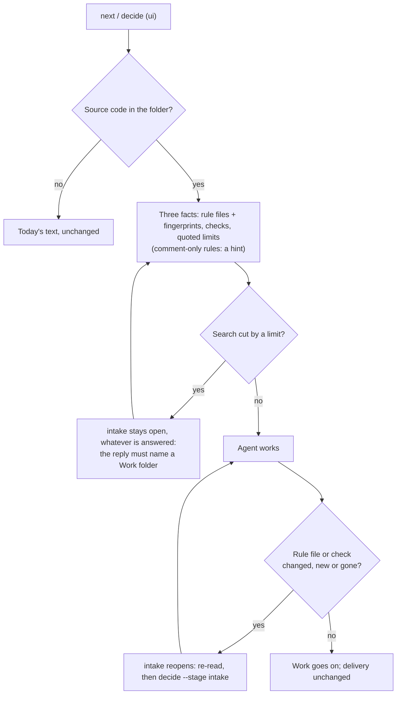

# Existing project intake for ui (spec, draft)

Status: draft, awaiting approval (2026-10-01). Nothing is approved or built. The approval text is
`openspec/changes/add-existing-project-intake/proposal.md`. This page only adds the picture and the before/after text.

## What a user sees (`ui`, quick, KATANAview trial worktree)

Before (today's `next`, run read-only in the worktree):

```text
command: Follow references/pipeline-reference.md at the quick tier (no OpenSpec; create DESIGN.md/MOTION.md only at
  standard if missing), verify the rendered surface, then: designer-pipeline decide --project-root . --stage deliver
  --answer <evidence>
```

After (from a throwaway prototype on the same folder; tests read fields and a few paths, not the prose):

```text
command: This folder already has source code, so the project's own files decide. Read first: CONTEXT.md and 17 more
  files (listed in project.rules). Limits and extension points they name: CONTEXT.md:19, CONTEXT.md:7,
  docs/ux/UX_DECISION_LEDGER.md:4. Checks: test `pnpm run test`; type-check `pnpm exec tsc --noEmit`; lint none
  found; build `pnpm run build`. 21 source files hold rules only in code comments: a hint, not tracked; open the top
  of each file you change. These checks do not show how the screen looks; a person decides that. When done:
  designer-pipeline decide --project-root . --stage deliver --answer <evidence>
project.rules[0]       CONTEXT.md, root, fingerprint 09387b2e6bdf (a short code from its contents); 18 files in all
project.boundaries[0]  CONTEXT.md:19, forbidden, "…禁区:订单流 canvas 引擎、注册表/架构、任何契约层…" (shortened)
a rule file edited, added or deleted, or the test script changed   ->   stage intake reopens:
  stale = [{ path: "CONTEXT.md", change: "changed" }]; the agent reads it again and runs decide --stage intake
a rule comment in a source file edited   ->   nothing reopens (a hint, not tracked)
a project too big to scan fully   ->   stage intake stays open, whatever is answered: "The project is too big to scan
  fully, so I cannot confirm the project rules have not changed. End your reply with 'Work folder: <folder>'."
```

## The picture


