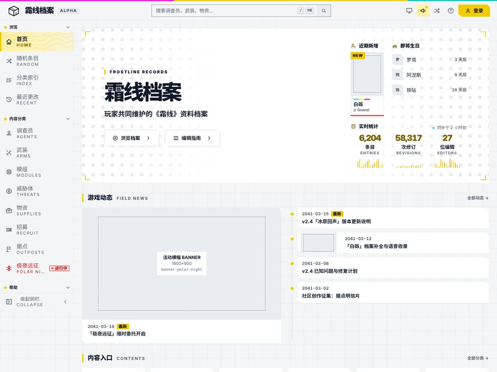
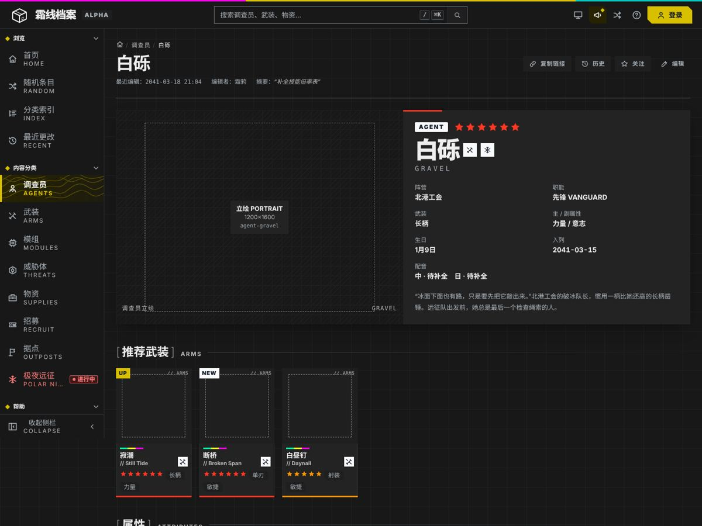
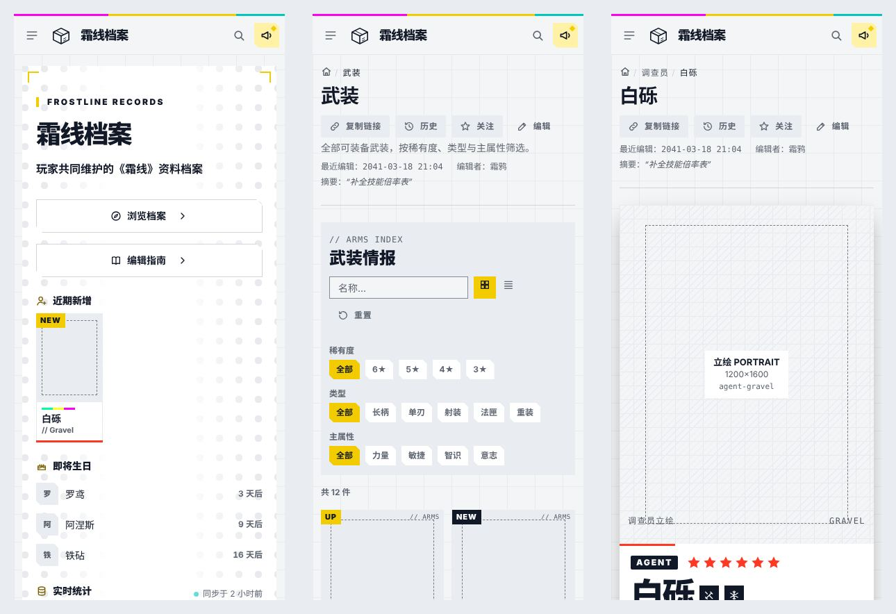

# Archive Terminal：游戏资料站组件库与 wiki 模板

一套“游戏终端”语法的 wiki 组件库和页面模板：浅灰底上 40px 细网格，白色切角面板，唯一的黄色强调色，中文名配英文大写小字的双语标签，角标、点阵、细斜纹和三色信号条。亮色与暗色两套主题，390 宽手机可用。



示例内容是虚构游戏《霜线》（FROSTLINE）的资料站；游戏、人物、武装、物资与活动都是编的。语法量自一个玩家社区维护、界面仿照游戏内 UI 的游戏 wiki，只带走了数字和规则，见 [GRAMMAR.md](GRAMMAR.md)。

## 打开

```bash
cd examples/archive-terminal-wiki-kit
python3 -m http.server 8820      # 或任何静态服务器
# 浏览器打开 http://127.0.0.1:8820/templates/index.html
```

也可以直接双击 `templates/*.html`。首页第一次打开会弹版本公告（`?notice=1` 强制弹出，`?notice=0` 不弹），主题按钮在“跟随系统 / 亮 / 暗”之间切换，侧栏可收起，`/` 或 ⌘K 聚焦搜索。

## 里面有什么

| 路径 | 内容 |
| --- | --- |
| `GRAMMAR.md` | 量出来的语法：颜色、字号、间距、切角、阴影、母题、强调色规则、动效，以及为什么参考站的代码和素材不在这里 |
| `DESIGN.md` / `MOTION.md` | Google 格式的设计基础与动效基础（front matter 由 `design-system design-md-tokens` 生成） |
| `design-system/` | design-system 包：`tokens.json`、使用规则 `README.md`、22 个组件（各有 README 与预览）、封面、共用的 `components/bundle.css` |
| `templates/` | 七个页面模板 + 一览页：首页、调查员详情、武装索引（筛选 / 表格）、物资详情、活动文章、最近更改、站内搜索；`kit.js` 是全部交互 |
| `art-tasks/` | 每种图位一份出图任务单（尺寸、安全区、留白、光、色板、提示词）和 `tasks.json` |
| `build/` | 生成器：模板、预览和 `templates/tokens.css` 都由它从同一份组件标记生成 |



## 改它

- 颜色、字号、间距只改 `design-system/tokens.json`，然后 `node examples/archive-terminal-wiki-kit/build/build.cjs` 重新生成 `templates/tokens.css`，再把 `design-system design-md-tokens` 的输出替换进 `DESIGN.md` 的 front matter。
- 组件样式改 `design-system/components/bundle.css`（页面与预览共用）；组件标记改 `build/parts.cjs`，页面结构改 `build/pages.cjs`，改完跑生成器。不要直接改生成出来的 `templates/*.html` 和 `preview.html`，`build.cjs --check` 会报出来。
- 图位：把 `.at-slot` 换成同宽高比的 ``，按 `data-task` 对应的任务单出图。

## 检查

```bash
node skill/scripts/designer-pipeline.cjs design-system check --project-root examples/archive-terminal-wiki-kit
node skill/scripts/designer-pipeline.cjs foundation check --kind all --project-root examples/archive-terminal-wiki-kit
node skill/scripts/designer-pipeline.cjs template check examples/archive-terminal-wiki-kit/templates/home.html --browser
node skill/scripts/designer-pipeline.cjs template check examples/archive-terminal-wiki-kit/templates/entity.html --browser --size 390x4800
```

结构与约束通过，不等于视觉验收；视觉由主人看图决定。


