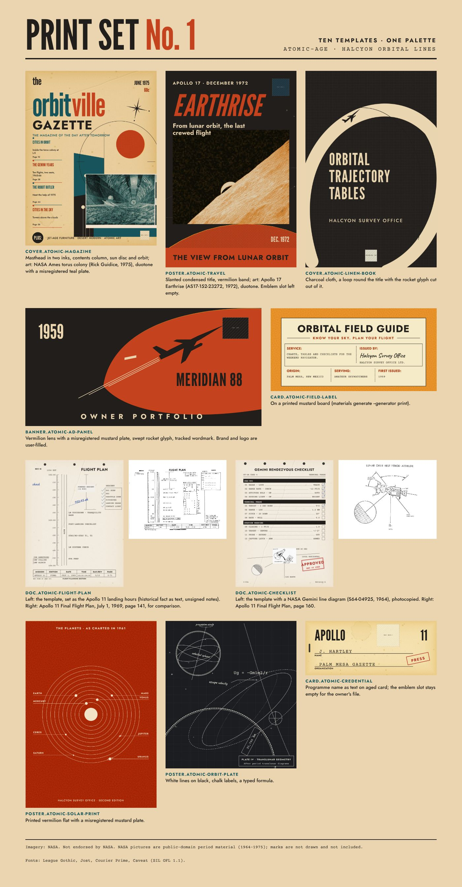
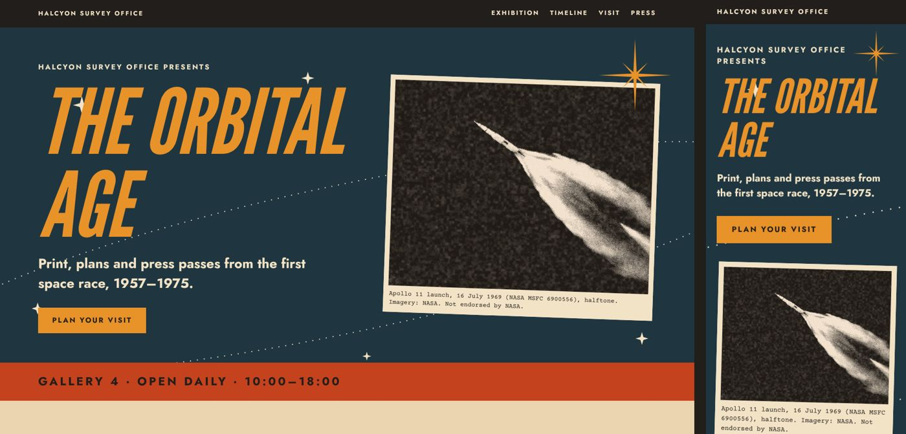
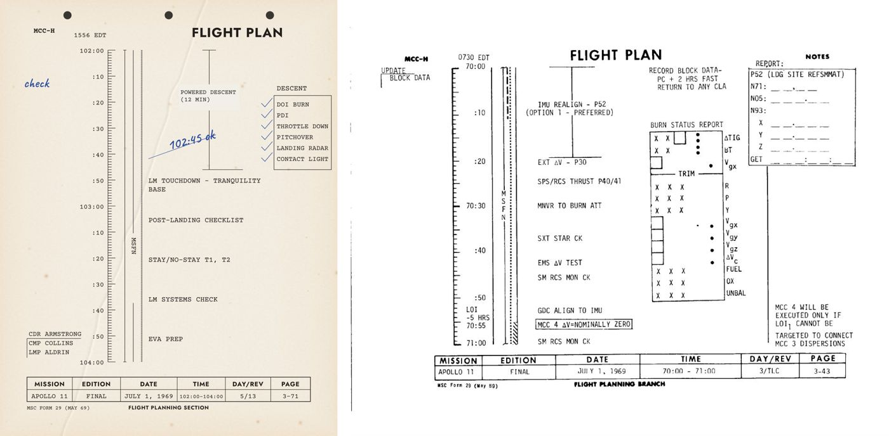

# Atomic Age：太空时代复古未来主义的印刷套组与着陆页

风格包 `atomic-age` 的示例：一张把十个模板全部填满的印刷套组表，和一个同语法的着陆页（1440 与 390 宽）。两套相连的语法：原子时代的杂志、海报、书封、广告与标签（奶油纸上一个朱红主色，对青、芥黄、炭黑），和早期载人航天的任务文件（打字机等宽、每分钟一格的时间刻度、版次表、打孔、印章、不署名的批注、黑底白线图版、记者证）。



内容分两层：原创世界（翠鸟测绘局 Halcyon Survey Office、《Orbitville Gazette》、Meridian 88）和作为史实写进去的真实历史（任务、日期、乘组姓名只出现在文件类页面里）。语法量自主人提供的情绪板（私下测量，不进仓库），见 [GRAMMAR.md](GRAMMAR.md)。借语法，不借素材。

## 打开

```bash
cd examples/atomic-age-kit
python3 -m http.server 8840
# http://127.0.0.1:8840/sheet.html       印刷套组
# http://127.0.0.1:8840/site/index.html  着陆页；?slot=1 显示美术位占位
```

## 里面有什么

| 路径 | 内容 |
| --- | --- |
| `sheet.html` | 印刷套组：十个模板的成品图与说明，飞行计划和检查单旁边并排放 Apollo 11 最终飞行计划的原页 |
| `site/` | 着陆页 `index.html`（海报首屏、杂志目录、飞行计划时间线、黑底图版、田野指南卡、记者证表单）、`atomic.css`（字体与色板）、`site.css` |
| `renders/` | 十个模板按 `build/data.cjs` 填好、带 `--font-dir` 和 `--browser` 渲出的 JPG |
| `build/` | `data.cjs`（每个模板填什么）、`build.cjs`（静态检查；`--browser` 重渲 `renders/`） |
| `art/` | 用到的图：NASA 1964–1975 年的公有领域图片经 `materials process` 印成双色网点、网点或复印；`materials generate` 做的老化纸和印刷平涂；`provenance.json` 逐张记来源、NASA 编号与日期、处理参数与种子、sha256；`materials-licenses.json` 是 materials 记录原文 |
| `fonts/` | League Gothic、Jost、Courier Prime、Caveat 的 OFL 子集与许可全文 |
| `art-tasks/` | 两个没有合适年代图片的美术位的出图任务单 |



## 规矩

- **标志不画、不放**：NASA 徽记、国徽、品牌字标都不在仓库里；模板上的 `logo` / `emblem` / `publisher_mark` 留成写明尺寸与留白的空槽，由主人自己放官方文件。
- **NASA 图片**只用 1957–1975 年 NASA 自己出的（发射、地月、技术插图、概念画），不用有可辨认宇航员的照片做宣传类版面；处处署 “Imagery: NASA. Not endorsed by NASA.”。
- **批注不署名**，不给真人编引语或背书。
- 火箭、卫星只作扁平字形；写实场景走美术位。

## 改它

- 文案和填图改 `build/data.cjs`，然后 `node examples/atomic-age-kit/build/build.cjs` 跑静态检查，`--browser` 重渲 `renders/`（需要 headless Chrome 与 ffmpeg）。
- 新图先在 materials 项目里 `materials add` / `process` / `generate`，再把输出放进 `art/` 并在 `provenance.json` 记一条（测试会核对 sha256 和年代）。
- 加了新字符要重做 `fonts/` 子集（测试会报出缺的字）。

## 检查

```bash
node skill/scripts/designer-pipeline.cjs template list --style atomic-age
node examples/atomic-age-kit/build/build.cjs
node skill/scripts/designer-pipeline.cjs template check examples/atomic-age-kit/sheet.html --browser --size 1440x<页高>
node skill/scripts/designer-pipeline.cjs template check examples/atomic-age-kit/site/index.html --browser --size 390x<页高>
```

结构与约束通过，不等于视觉验收；视觉由主人看图决定。


