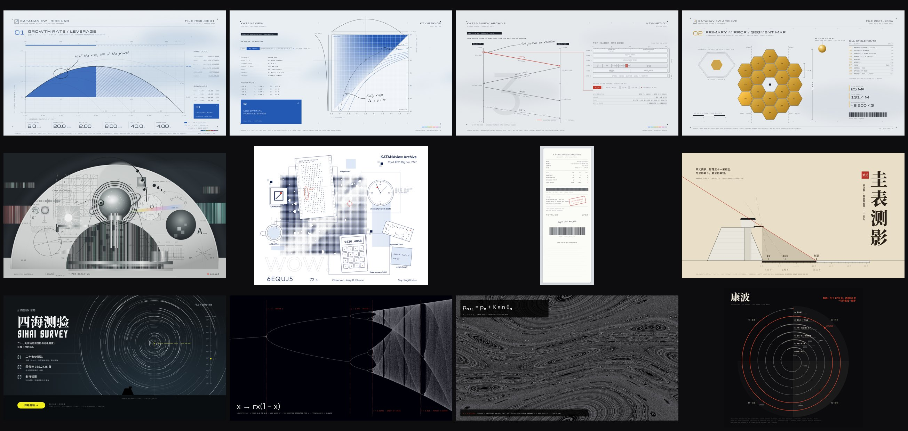

# Computed sheets kit

Forty-two pieces where the picture is computed, not drawn: document sheets about real subjects,
other media in the same grammar, and figures where the mathematics is the image. Every hero is
calculated from data or a formula in its build script; facts carry their sources in the footer, and
values that are examples or schematic say so.



```sh
python3 build/dense.py          # numpy rasters into art/ (Buddhabrot takes about two minutes)
python3 build/collage.py        # the material triptych into art/
python3 build/engine_render.py && python3 build/engine_post.py   # ray-marched depth canyon
python3 build/constructivist.py # faktura composition (needs art/foam.png from collage.py's crust)
node build/all.cjs              # every piece into renders/, plus renders/index.html
```

| Script | What it makes |
| --- | --- |
| `kelly-dialects.cjs`, `kelly-2d.cjs` | One computed hero (Kelly growth curve, 2-D surface) in the terminal, paper and field dialects |
| `protocol-tcp.cjs`, `structure-webb.cjs` | Protocol sheet (sequence ladder + header bit map) and structure sheet (Webb mirror segments + bill of elements) |
| `pulsar-collage.cjs`, `technetium-kv.cjs`, `object-cards.cjs` | Half-dome specimen collage (CP 1919), key visual with a 3D render slot (element 43), line-art object cards (Big Ear 1977) in four styles |
| `teaser.cjs` | Beat-cut teaser on a 120 BPM grid, 15 s loop |
| `media.cjs` | The grammar on other media: thermal receipt, release sheet, 404 page, CR80 badge, timeline ribbon, small multiples, circular dial |
| `fusion.cjs` | Game-grammar pieces laid out by hand: gnomon key visual, survey briefing under computed star trails, element entrance |
| `math.cjs`, `dense.cjs` + `dense.py` | Lorenz, phyllotaxis, Fourier/Gibbs, Ulam, Kepler's second law, logistic bifurcation; Buddhabrot, Chirikov standard map, de Jong, Clifford, Lyapunov |
| `kondratiev.cjs` | Kondratiev waves as a spiral, one turn per wave, with one lifetime drawn across it |
| `collage.cjs` + `collage.py` | Material triptych where every texture is computed: sand ripples under torn paper, a dusk gradient, a porous crust of spherical cavities at three scales |
| `engine_render.py`, `engine_post.py`, `constructivist.py`, `engine-and-faktura.cjs` | The depth canyon as a real-time-engine still: heightfield ray marching with soft shadows, AO, height fog, god rays, depth of field, bloom and ACES; and a constructivist composition where each computed material is cut by a geometric mask |
| `holo-depth.cjs` | The order book as a hologram: a 3D wireframe of 46 snapshots floating over a projector, additive cyan glow, chromatic ghost, scanlines and flicker, rings on the base plate, HUD cards at three depths with the near ones defocused; data simulated and labelled SIM |
| `holo-nihei.cjs`, `holo-space.cjs` + `grit.py` | The orange hologram in an ink-hatched megastructure and in deep space (gas giant, rings, asteroid ship). `grit.py` turns a clean screenshot into one taken off dirty glass: unstable projection bands and torn lines, channel misregistration, smudge glow, shadow halftone and ink speckle, lens scratches and dust, grain, vignette. Finished frames in `art/holo-*.jpg` |
| `depth-sheet.cjs` + `depth-scene-mega.cjs`, `depth-scene-space.cjs` | The hologram as a working sheet: header, protocol column, a bid/ask ladder for the latest snapshot, a projection window, callouts at the scene's exported anchors, a metrics row and sources. The scenes are screenshotted at 2× and passed through `grit.py --light` into `art/depth-scene-*.jpg`; the sheet clips that into the hero window and draws all text over it as vector |
| `depth-3d.cjs` | Order-book depth canyon in a game-UI frame: 91 L2 snapshots × 10 levels, three depth bands (blurred far plane with fog, sharp middle, blurred foreground), bloom on the ask wall, dust, book bars, imbalance dial, reticle and tape strip; data simulated and labelled SIM |

## What the kit taught

- **The figure is the design.** The pieces that work are the ones whose hero is computed (a bifurcation
  diagram, a ground track, noon shadows from latitude). Slot-filling a game template with a diagram
  did not work and was dropped.
- **Grammar is chosen per subject, not stamped.** Neutral ground, one subject, a shared left line,
  condensed Latin over a CJK serif: each is an option. The gnomon key visual uses warm sand, a vertical
  title and a seal red; the element entrance is full-bleed fluorescent; the survey briefing is a night sky.
- **Grit stays in the picture, never on the words.** On a sheet people read, the raster carries the texture at a third of the strength and twice the resolution; numbers, labels and callouts are vector above it.
- **Clean is not finished.** A hologram that reads as real needs the faults of a real projection and a real lens; `grit.py` adds them after the render.
- **Honesty in the footer.** Example values get `*`; schematic layouts, models (equal season
  quadrants) and disputed chronologies (Kondratiev) say so on the page.
- For sheets about a real subject, start from the sheet kit in
  `skill/tools/template-bank/sheet-kit.cjs`; use these scripts as references for heroes it does not have yet.

Fonts are named and loaded from Google Fonts (IBM Plex Mono, Michroma, Outfit, Inter Tight, Nothing
You Could Do, Noto Serif SC, Noto Sans SC; all OFL). Nothing here imitates a real product's assets.
