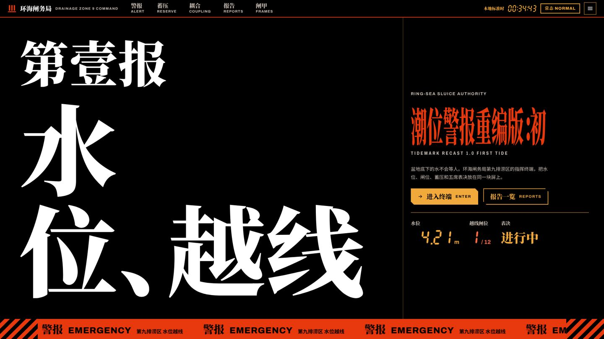
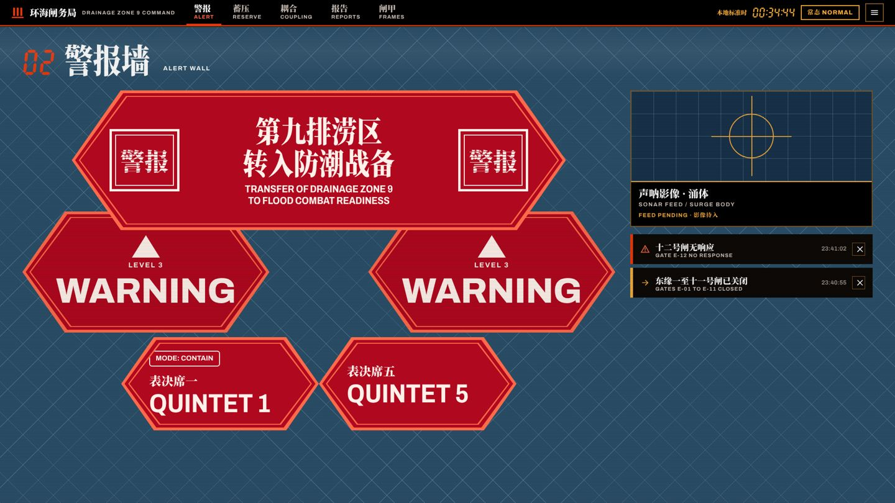
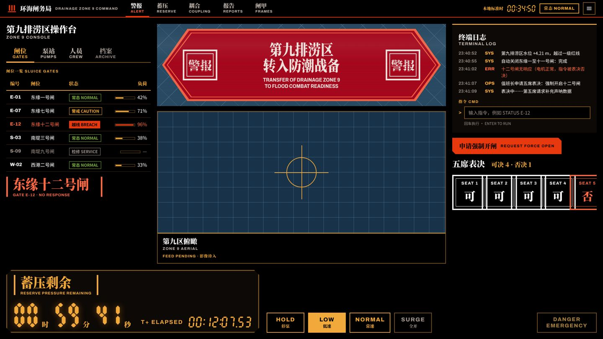

# Crisis Command：危机指挥终端组件库与示例站

一套“危机指挥终端”语法的组件库、组织终端示例站和两屏应用：黑底上压缩过的极粗明朝字卡，蓝屏上的红色长六边形警报墙，琥珀段码计时器，耦合曲线和五席表决。单一主题（Terminal），390 宽手机可用。



示例内容是虚构作品《潮位警报》TIDEMARK：环海闸务局守着一座建在沉降盆地里的城。组织、人物、地名、报告与文案全部原创。语法量自一部九十年代机甲动画及其重制电影的界面与字卡（私下测量，截图不进仓库，这里不点名），只带走了数字和规则，见 [GRAMMAR.md](GRAMMAR.md)。借语法，不借素材。

## 打开

```bash
cd examples/crisis-command-ui-kit
python3 -m http.server 8830      # 或任何静态服务器
# 浏览器打开 http://127.0.0.1:8830/templates/index.html
```

也可以直接双击 `templates/*.html`。`site.html?slot=1` 显示占位模式：每个美术位换成斜纹框，标出任务 id、尺寸和安全区；默认是展示模式，美术位是空监视器，不放角色和机体。蓄压屏的“模拟越线”按钮把整页硬切到危险态。

## 里面有什么

| 路径 | 内容 |
| --- | --- |
| `GRAMMAR.md` | 量出来的语法：整屏构图、色板、字体与四档压缩比、字卡、片名卡、警报墙、计时屏、线框母题、动效节奏、文字排法 |
| `DESIGN.md` / `MOTION.md` | Google 格式的设计基础与动效基础（front matter 由 `design-system design-md-tokens` 生成） |
| `design-system/` | design-system 包：`tokens.json`、使用规则 `README.md`、26 个组件（各有 README 与预览）、封面、共用的 `components/bundle.css` |
| `templates/` | 组织终端站 `site.html`（6 屏）、操作台 `console.html`、出动耦合监视 `sync.html`、一览页 `index.html`；`kit.js` 是全部交互，`seg.js` 画段码数字，`pages.css` 只管排版 |
| `fonts/` | Noto Serif SC Black 与 Archivo 的 OFL 子集（只含本示例用到的字），附 OFL 全文 |
| `art-tasks/` | 每个美术位一份出图任务单、`tasks.json` 和合成层序 `layers.json` |
| `build/` | 生成器：页面、预览和 `templates/tokens.css` 都由它从同一份组件标记生成 |



## 改它

- 颜色、字号、间距只改 `design-system/tokens.json`，然后 `node examples/crisis-command-ui-kit/build/build.cjs` 重新生成 `templates/tokens.css`，再把 `design-system design-md-tokens` 的输出替换进 `DESIGN.md` 的 front matter。
- 组件样式改 `design-system/components/bundle.css`（页面与预览共用）；组件标记改 `build/parts.cjs`，页面结构改 `build/pages.cjs`，文案改 `build/data.cjs`，改完跑生成器。不要直接改生成出来的 `templates/*.html` 和 `preview.html`，`build.cjs --check` 会报出来。
- 加了新字就要重做 `fonts/` 的子集（测试会报出缺的字）：`pyftsubset NotoSerifCJK-Black.ttc --font-number=2 --text-file=<全部用字> --flavor=woff`。
- 美术位：按 `art-tasks/` 的任务单出图，再把 `.cc-slot` 换成同宽高比的 ``；机甲和人物不要用代码画。

## 检查

```bash
node skill/scripts/designer-pipeline.cjs design-system check --project-root examples/crisis-command-ui-kit
node skill/scripts/designer-pipeline.cjs foundation check --kind all --project-root examples/crisis-command-ui-kit
node skill/scripts/designer-pipeline.cjs template check examples/crisis-command-ui-kit/templates/console.html --browser
node skill/scripts/designer-pipeline.cjs template check examples/crisis-command-ui-kit/templates/sync.html --browser
```

同一语法的风格包是 `crisis-command`（`template list --style crisis-command`）。结构与约束通过，不等于视觉验收；视觉由主人看图决定。


