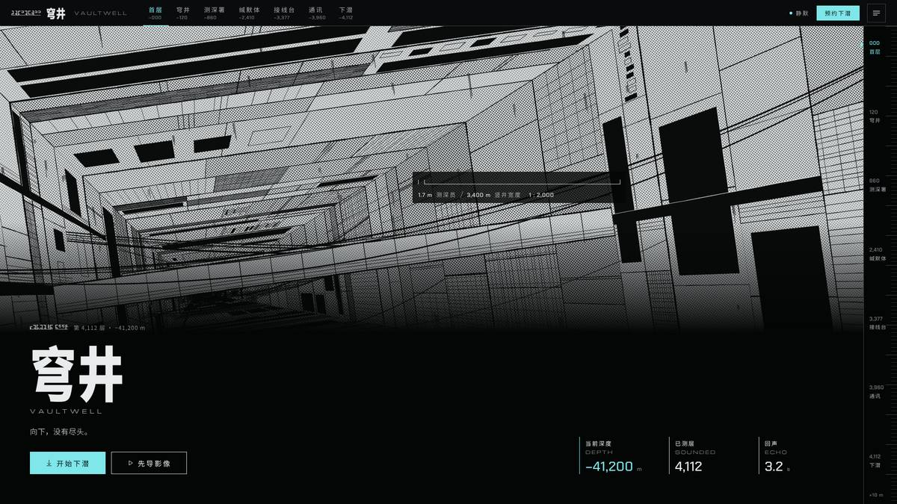
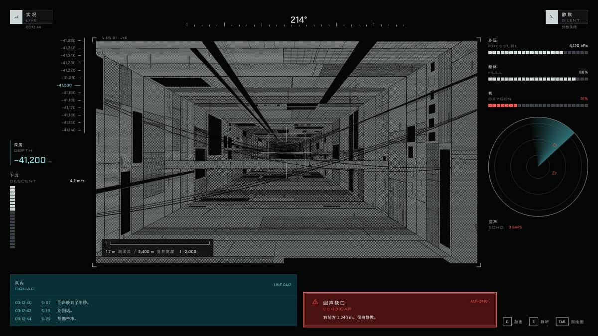
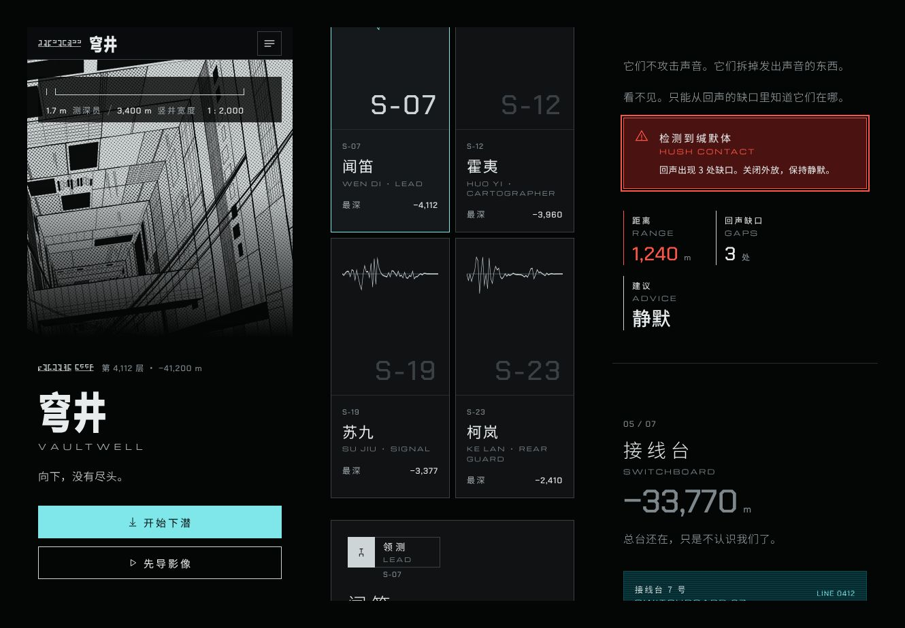

# Megastructure Ink：巨构墨线风格的组件库、官网与游戏内界面

一套“无尽巨构”语法的组件库和页面：黑与冷灰，只有一种光；结构用墨线、网点和排线画，人只用比例标表示；白色发丝线的座舱 / 终端界面，青色单色监视屏，自己设计的层文字形，几乎没有字。单一暗色主题，390 宽手机可用。



示例内容是虚构作品《穹井》（VAULTWELL）：一座只向下生长的结构，测深署用回声丈量深度，缄默体会拆掉发出声音的东西。名称、人物、组织、文案都是原创。语法量自一类巨构漫画和它的动画改编，只带走数字和规则，见 [GRAMMAR.md](GRAMMAR.md)。

## 打开

```bash
cd examples/megastructure-ink-kit
python3 -m http.server 8830      # 或任何静态服务器
# http://127.0.0.1:8830/templates/index.html
```

| 页面 | 内容 |
| --- | --- |
| `templates/index.html` | 组件一览（26 个组件） |
| `templates/site.html` | 官网，一页七屏：首层、穹井、测深署、缄默体、接线台、通讯记录、下潜 |
| `templates/site.html?slot=1` | 占位模式：每个美术位显示尺寸、安全区和任务单编号 |
| `templates/hud.html` | 游戏内下潜 HUD（1920×1080） |
| `templates/terminal.html` | 游戏内测绘终端（1920×1080） |

展示模式不画人：美术位里是 `templates/plates.js` 程序生成的结构版画（竖井、梁、缆束、网点，按种子确定），测深员卡片用回声波形和编号代替立绘。人物、缄默体和真正的主视觉按 `art-tasks/` 的任务单出图，按 `layers/` 的层契约合成。



## 里面有什么

| 路径 | 内容 |
| --- | --- |
| `GRAMMAR.md` | 量出来的语法：整屏构图、色、字、栅格、母题、动效，以及和原作差在哪里 |
| `DESIGN.md` / `MOTION.md` | Google 格式的设计基础与动效基础（front matter 由 `design-system design-md-tokens` 生成） |
| `design-system/` | design-system 包：`tokens.json`、使用规则 `README.md`、26 个组件（各有 README 与预览）、封面、`components/bundle.css`、`fonts/`（Michroma 与 Chakra Petch 的 OFL 拉丁子集） |
| `templates/` | 四个页面与 `kit.js`（交互）、`plates.js`（结构版画）、`glyphs.js`（层文） |
| `art-tasks/` | 每个美术位一份出图任务单和 `tasks.json` |
| `layers/` | 首屏主视觉和测深员立绘的层契约（`design-pipeline.layer-contract.v1`） |
| `build/` | 生成器：页面、预览和 `templates/tokens.css` 都从同一份组件标记生成 |

## 改它

- 颜色、字号、间距只改 `design-system/tokens.json`，再跑 `node examples/megastructure-ink-kit/build/build.cjs`，并把 `design-system design-md-tokens` 的输出换进 `DESIGN.md` 的 front matter。
- 组件样式改 `design-system/components/bundle.css`；标记改 `build/parts.cjs`，页面结构改 `build/pages.cjs`，内容改 `build/data.cjs`，然后跑生成器。不要直接改生成出来的 `templates/*.html` 和 `preview.html`，`build.cjs --check` 会报出来。
- 美术位：把 `.ms-slot` 换成同宽高比的图，按 `data-task` 对应的任务单出图。
- 中文永远不放进 Michroma / Chakra Petch（只有拉丁子集）：读数里有中文时用 `.readout.is-cjk`，小字用 `label`。

## 检查

```bash
node skill/scripts/designer-pipeline.cjs design-system check --project-root examples/megastructure-ink-kit
node skill/scripts/designer-pipeline.cjs foundation check --kind all --project-root examples/megastructure-ink-kit
node skill/scripts/designer-pipeline.cjs template check examples/megastructure-ink-kit/templates/hud.html --browser --size 1920x1080
```

官网每屏的最小高度是 `min(100vh, 1080px)`，所以整页检查用页面实际高度作 `--size`（1920 宽约 1920×8870）。结构与约束通过，不等于视觉验收；视觉由主人看图决定。


