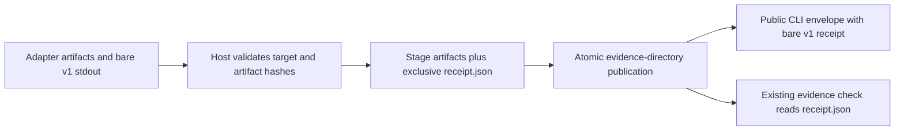

## Decision

The capture host owns `receipt.json`. After validating adapter stdout, artifact hashes and the requested target, write the bare existing v1 receipt exclusively in the private stage. Then rename the directory. The receipt is metadata, not an artifact/hash entry. The public capture dispatcher takes the host result's `receipt` member; generic `runKernel` remains untouched.

## Data flow

## Failure and compatibility

An adapter-created file or link named `receipt.json` causes exclusive creation to fail; it is not overwritten and the host removes only its owned stage. Write or rename failure retains existing failure envelopes and cleanup. A pre-existing final output directory is never overwritten. Partial, blocked and unknown receipts remain honest and use the existing schema. Saved-state secret bytes are not copied into the receipt.

Artifact files and their parents below the resolved evidence root must not be links. A contained absolute directory link can point into the stage, pass the old containment/hash checks, then dangle after rename. The shared `validateReceipt` file check rejects each linked path component before publication; checker and runtime-review consumers use the same rule. Ordinary nested directories remain supported.

Bundled adapters need no changes. The only known consumer of the erroneous nested shape is migrated in the saved-state public CLI regression. Documentation reserves the metadata filename explicitly rather than quietly changing artifact ownership. No global kernel unwrapping, fallback schemas or new flags.

## Acceptance

Run public capture against controlled external-tool primitives, then invoke the real public checker against the published receipt and artifact hashes. Cover complete and partial results, filename collision, linked-parent rejection, ordinary nested artifact paths and failed-stage cleanup. Preserve saved-state privacy. Run strict OpenSpec validation and the repository's complete `npm test` gate; a missing environment prerequisite or unrelated baseline failure is not a passing gate.
