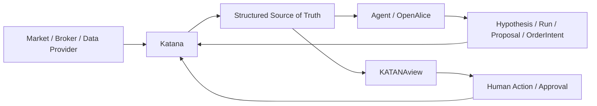
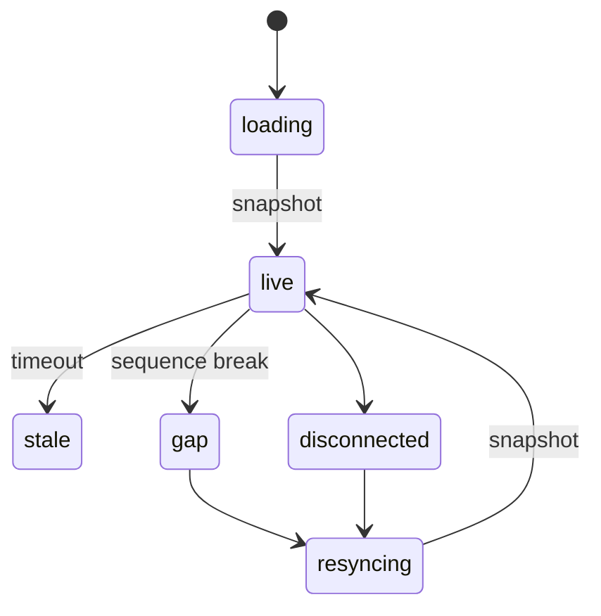
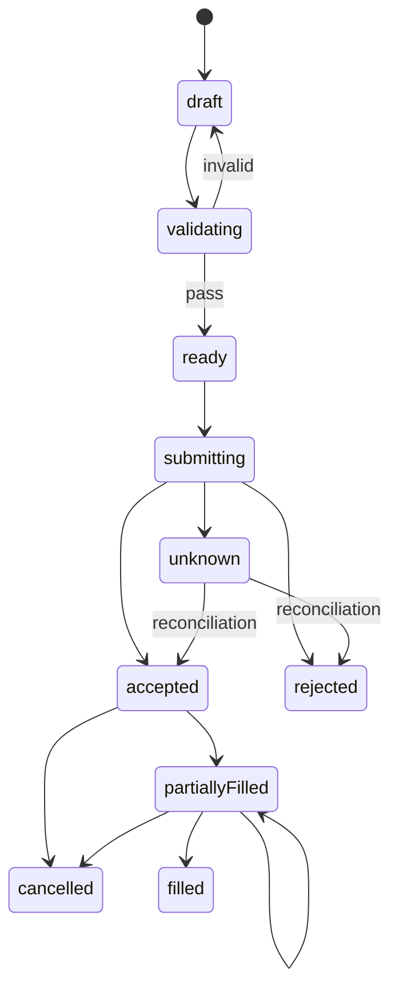

# KATANAview Professional Tool Specs：可直接交付 Claude 的 MVP 规格包

## 交付物清单与使用说明

这套交付物的目标不是继续让 Claude “理解我们想做什么”，而是**尽可能消除它重新定义专业工具范围的自由度**。

参考项目已经替我们回答了大量专业金融工具“应该具备什么”的问题：ATAS Classic 已明确覆盖 Footprint、Bid×Ask、Delta、Market Profile、Smart DOM、Smart Tape、Replay 与 Chart Trader；TapeDelta 的公开示例覆盖 Footprint、DOM、订单簿历史 Heatmap、TPO/VRVP 与 Replay；Bookmap 将全深度流动性热力图、成交气泡、当前订单簿和全深度 Replay 作为核心订单流能力；TradingView 则提供图表、同步、布局、Replay、Watchlist 和交易交互的成熟基线。turn1view3turn1view0turn1view1turn4view0turn10view1

另一方面，tick-stock-panel 已经把 A 股筛选、指标、因子编辑/校验、IC/IR、回测、分钟信号、监控、模拟账户和数据扩展连成比较完整的研究链路；FinceptTerminal 当前公开项目则覆盖多资产研究、组合、回测、风险、衍生品、固定收益、AI Quant Lab、Paper Trading 和 Broker integrations。turn8view0turn15search1turn16view0

因此，本规格包采用：

```text
成熟产品功能
      ↓
去重
      ↓
按专业工具重新归并
      ↓
定义跨市场数据契约
      ↓
定义 Human Representation
      ↓
定义 Agent Artifact
      ↓
MVP / P1 / P2
      ↓
逐项 Acceptance
      ↓
Claude 直接实现
```

建议目录直接保存为：

```text
KATANAview/
├─ PRODUCT.md
├─ TOOLS/
│  ├─ INDEX.md
│  ├─ chart.md
│  ├─ dom.md
│  ├─ footprint.md
│  ├─ smart-tape.md
│  ├─ l2-heatmap.md
│  ├─ volume-profile.md
│  ├─ replay.md
│  ├─ watchlist.md
│  ├─ screener.md
│  ├─ order-ticket.md
│  ├─ order-blotter.md
│  ├─ positions-account-book.md
│  ├─ factor-workbench.md
│  ├─ backtest-workbench.md
│  ├─ portfolio-risk.md
│  ├─ agent-task.md
│  ├─ agent-evidence.md
│  ├─ agent-approval.md
│  ├─ data-quality.md
│  └─ ...
├─ SOURCE_MAP.md
└─ THIRD_PARTY_NOTICES.md
```

### 给 Claude 的固定施工指令

每次只给 Claude：

```text
PRODUCT.md
+
一个 TOOLS/<tool>.md
+
当前仓库代码
```

启动 Prompt 固定为：

```text
你正在实现 KATANAview。

只读取：
1. PRODUCT.md
2. 本次指定的 TOOLS/<tool>.md
3. 当前仓库相关代码

不要重新定义该工具需要哪些功能。
不要重新做产品架构。
不要因为后端尚未接通而删除专业功能。

规则：

1. 先检查仓库现有组件和代码。
   已有功能扩展，不得仅因命名不同重新造一份。

2. 所有 [MVP] 项均为本轮必须实现的产品范围。

3. [P1] / [P2] 若本轮不实现：
   - 保留正确的数据类型和 adapter port；
   - UI 不得显示假功能；
   - 不得放一个永远成功的按钮冒充实现。

4. 后端尚缺时：
   - 使用 deterministic fixture；
   - 明确显示 FIXTURE / PAPER / REPLAY；
   - typed adapter 必须与未来 Katana 接口可替换。

5. 真实市场、订单、成交、Agent 执行不能用固定成功动画冒充。

6. loading/live/stale/gap/resyncing/replay/unsupported/error
   必须可以独立触发和测试。

7. 人看到的数据和 Agent artifact 必须来自同一个事实源。

8. 每个 Acceptance 项逐条给出：
   PASS / FAIL / BLOCKED
   + 修改文件
   + 测试入口
   + 尚缺后端接口。

不要只返回计划。实际实现并运行测试。
```

**Source Feature ID 约定**

本报告沿用你现有 904 条功能底账中的 ID：

`FIN-*` = FinceptTerminal；`TSP-*` = tick-stock-panel；`ATC-*` = ATAS Classic；`ATX-*` = ATAS X；`TV-*` = TradingView；`TD-*` = TapeDelta；`OTU-*` / `OTL-*` = OpenTerminalUI 分支；`NTA-*` / `NTW-*` = Nautilus 社区前端；`OBB-*` / `OBW-*` = OpenBB；`OA-*` = OpenAlice。

Bookmap、Binance/SSE 官方 API 等后来加入但不在原 904 表内的证据，一律写：

> **未定位（未纳入 904 表）**

不伪造 ID。

## Executive Summary：MVP 到底应该是什么

KATANAview 的 MVP 不应该被定义成“小型 Dashboard”，而应该定义成：

> **第一套真正能服务 Human + Agent 的专业市场、研究、账户和执行工具集合。**

KATANAview 的核心身份是 **Autonomous Quant System 的 Human Interface**。Agent 从 Katana 获得结构化 Market Data、Account State、Run、Artifact、Order、Risk 与 Evidence；人类通过 KATANAview 看到同一事实的专业表达。OpenAlice 一类 Agent 工作空间则负责 Session、Issue、研究任务、Artifact 和交易 Proposal/Approval。OpenAlice 当前公开 README 确实将 Workspace、持续研究、Unified Trading Account、Agent 暂存交易提案及审阅批准作为其体系的一部分，并明确建议实验交易优先使用 simulator/paper/demo/testnet。turn17view0

因此不能出现：

```text
Agent 看到：
BTC position = 3.0

Human UI 自己算：
BTC position = 2.7
```

也不能：

```text
Agent：
Order submitted

UI：
✓ Filled
```

正确关系是：



对于 Crypto，MVP 从一开始就必须以 **L2 是一等数据**为前提，而不是等未来补。Binance 官方 Spot WebSocket 文档提供实时 best-bid/ask 与 diff depth 更新流，diff-depth 事件携带更新 ID 和 bid/ask 价量变化；其衍生品 API 也提供订单簿和 Open Interest 等市场数据。因此我们定义的 DOM、Heatmap、Replay 不应只接受“当前五档数组”，而应从 `snapshot + ordered deltas + sequence state` 建模。turn20view0turn19view3

### MVP 第一批工具

| 工具 | 为什么必须进 MVP |
|---|---|
| Professional Chart | 所有行情、研究、执行证据的基本视觉入口 |
| DOM / Price Ladder | L2 当前状态、流动性与交易入口 |
| Footprint / Cluster | 成交主动性、Delta、价位成交结构 |
| Smart Tape | 原始成交与大单/成交节奏 |
| L2 Heatmap | L2 历史，不只是“当前盘口” |
| Volume / Market Profile | 价格分布、POC、Value Area |
| Replay / Market Simulator | 研究、复盘、Paper、Agent 评估共同基础 |
| Watchlist / Market Monitor | 7×24 多市场态势入口 |
| Screener / Scanner | 从“观察市场”进入“发现机会” |
| Order Ticket | 人/Agent 的交易意图输入 |
| Order Blotter | 执行状态与异常监控 |
| Positions / Account Book | 系统实际资金与仓位事实锚点 |

第一批完成后，紧接着补：

**Factor Workbench、Backtest Workbench、Portfolio/Risk、Agent Task、Agent Evidence、Agent Approval、Data Quality。**

这样开源版第一阶段就已经形成：

```text
MARKET
Chart / DOM / Footprint / Tape / Heatmap / Profile

DISCOVERY
Watchlist / Scanner

SIMULATION
Replay

CAPITAL
Account / Positions

EXECUTION
Order Ticket / Blotter

AGENT
Task / Evidence / Approval

RESEARCH
Factor / Backtest / Risk
```

而不是一个“高度可扩展、但 clone 下来没有专业工具”的空 Framework。

## 公共数据契约、状态与跨市场规则

下面这部分应该**复制进每一个独立 Tool Spec 的数据章节**，这样 Claude 在只读一个工具文件时也不会缺上下文。

### 核心市场对象

```ts
export type MarketMode =
  | "live"
  | "paper"
  | "shadow"
  | "replay";

export interface InstrumentRef {
  instrumentId: string;
  symbol: string;
  venue: string;

  assetClass:
    | "equity"
    | "future"
    | "option"
    | "crypto_spot"
    | "crypto_perp"
    | "fund"
    | "fx"
    | "other";

  baseCurrency?: string;
  quoteCurrency: string;
  settlementCurrency?: string;

  priceTick: number;
  qtyStep: number;
  contractMultiplier?: number;

  timezone: string;

  capabilities: string[];
}
```

**不能把市场规则写死在组件里。**

A 股、美股、期货、Crypto Perp 即使都使用 `OrderTicket`，可卖数量、价格档位、订单类型、结算、保证金、价格保护和交易时段也不同。上海证券交易所 2026 年修订后的交易规则仍包含申报数量、价格最小变动单位、价格限制和具体交易阶段等市场级规则，因此跨市场 UI 应从 `InstrumentRules/VenueCapabilities` 获取这些规则，而不是把“一手 100 股”“某个涨跌幅”做成全局常量。turn13search16

### 数据质量

```ts
export interface DataQuality {
  source: string;

  tsEvent?: string;
  tsRecv?: string;
  lastEventAt?: string;

  delayed?: boolean;
  stale: boolean;

  sequenceStatus?:
    | "ok"
    | "gap"
    | "resyncing"
    | "unknown";

  qualityFlags: string[];

  mode: MarketMode;
}
```

核心原则：

```text
0
≠
null
≠
unsupported
≠
stale
≠
not yet loaded
```

缺少 Funding 不能显示：

```text
Funding: 0.00%
```

而应该显示：

```text
Funding: —
Not applicable
```

或者：

```text
Funding: unavailable
Provider does not expose this field
```

### L1

```ts
export interface QuoteL1 {
  instrument: InstrumentRef;

  bidPx?: number;
  bidQty?: number;

  askPx?: number;
  askQty?: number;

  lastPx?: number;
  lastQty?: number;

  markPx?: number;
  indexPx?: number;

  quality: DataQuality;
}
```

### L2 Snapshot

```ts
export interface BookSnapshot {
  instrument: InstrumentRef;

  seq: string | number;

  bids: Array<[
    price: number,
    qty: number,
    orderCount?: number
  ]>;

  asks: Array<[
    price: number,
    qty: number,
    orderCount?: number
  ]>;

  depth: number;

  quality: DataQuality;
}
```

### L2 Delta

```ts
export interface BookDelta {
  instrument: InstrumentRef;

  firstSeq?: string | number;
  lastSeq: string | number;
  prevSeq?: string | number;

  bids: Array<[
    price: number,
    qty: number,
    orderCount?: number
  ]>;

  asks: Array<[
    price: number,
    qty: number,
    orderCount?: number
  ]>;

  quality: DataQuality;
}
```

默认行为：

```text
snapshot
   ↓
construct local book
   ↓
ordered delta
   ↓
incremental update
```

发生 sequence gap：

```text
live
 ↓
gap detected
 ↓
stop continuity-dependent calculations
 ↓
request snapshot
 ↓
resyncing
 ↓
atomic local-book replacement
 ↓
live
```

不允许：

```text
gap
↓
假装没发生
↓
继续算 imbalance / pulling / heatmap
```

Binance 官方 diff-depth 流明确包含用于维护更新顺序的 update IDs，因此以序列状态作为本地订单簿的数据质量一部分是符合实际市场数据接口形态的设计。turn20view0

### Trades

```ts
export interface TradePrint {
  instrument: InstrumentRef;

  tradeId?: string;

  tsEvent: string;
  tsRecv?: string;

  price: number;
  qty: number;

  aggressor?:
    | "buy"
    | "sell"
    | "unknown";

  venue?: string;

  flags?: string[];

  quality: DataQuality;
}
```

如果 Provider 没有 aggressor side：

```text
unknown
```

不是：

```text
默认为 sell
```

如果我们通过 quote rule 推断，则：

```ts
{
  aggressor: "buy",
  classification: "inferred",
  method: "quote-rule-v1"
}
```

### 公共状态

| State | Human 表达 | 行为 |
|---|---|---|
| `loading` | Skeleton + 标的/Provider | 不显示伪数据 |
| `live` | 正常 | 增量更新 |
| `stale` | 明显过期提示 | 显示 last-event time |
| `gap` | 序列缺口 | 暂停连续性派生计算 |
| `resyncing` | 正在重建 | 等新 snapshot |
| `replay` | 永久 REPLAY 标记 | 禁止真实 side effect |
| `unsupported` | 解释 capability 不存在 | 不用零值代替 |
| `degraded` | 部分功能可用 | 逐字段说明 |
| `disconnected` | 连接已断开 | 不显示实时绿灯 |
| `error` | 原因 + retry/diagnostics | 不自动称“已恢复” |

### 默认性能预算

这些是 KATANAview 的**可调整工程默认值**，不是参考产品公开承诺：

| 项目 | MVP 默认 |
|---|---:|
| 前端事件接收 → 本地状态应用 p95 | ≤ 5 ms / batch |
| 状态 → 可见 paint p95 | ≤ 50 ms |
| 用户操作 → 本地视觉反馈 p95 | ≤ 100 ms |
| 交互目标 | 60 FPS |
| 可接受持续最低 | 30 FPS |
| 主线程单个 long task | < 50 ms |
| 默认 L2 depth | 50 levels / side |
| 默认价格聚合 | 1 × `priceTick` |
| DOM > 200 levels | 强制 virtualize |
| Tape 可见/历史 rows | virtualization |
| Stream stale 默认 | max(2 sec, 3×expected interval) |
| Replay MVP speed | 0.25× / 0.5× / 1× / 2× / 5× / 10× |

ATAS 官方 Heatmap 页面强调其订单流工具以高帧率、全深度数据、缩放和实时同步为设计重点；Bookmap 同样把完整市场深度、流动性热力图与 tick/depth replay 作为核心。因此 KATANAview 的订单流工具不能用“每个市场事件触发 React 全树重渲染”的普通 Dashboard 架构来实现。turn1view2turn10view1

### 市场能力基线

`✓` 表示概念原生适用；`Provider` 表示取决于数据商；`Venue` 表示交易所/经纪商规则决定；`—` 表示通常不适用。它**不是交易规则数据库**。

| Capability | A股 | 美股 | 上市期货 | Crypto Spot | Crypto Perp | 上市期权 |
|---|---|---|---|---|---|---|
| L1 / BBO | Provider | Provider | Provider | ✓ | ✓ | Provider |
| Trades | Provider | Provider | Provider | ✓ | ✓ | Provider |
| L2 | Provider/授权 | Provider/授权 | Provider | ✓ | ✓ | Provider |
| 24×7 | — | — | — | ✓ | ✓ | — |
| Funding | — | — | — | — | ✓ | — |
| Open Interest | — | — | Provider | — | ✓ | Provider |
| Mark/Index Price | — | — | 参考/结算价 | — | ✓ | Provider |
| Reduce-only | — | — | Venue | — | ✓ | — |
| Post-only | Venue | Venue | Venue | Venue | Venue | Venue |
| Margin/Leverage | Account | Account | ✓ | Product | ✓ | ✓ |
| Sellability | Venue/Account | Venue/Account | Venue | Venue | Venue | Venue |
| Price/Qty Step | InstrumentRules | InstrumentRules | InstrumentRules | InstrumentRules | InstrumentRules | InstrumentRules |
| Session | Venue | Venue | Venue | 24×7 | 24×7 | Venue |

Crypto Perp 的具体 Funding/OI/Mark/Index 支持应由 Exchange Adapter 决定；例如 Binance 的衍生品接口公开提供 Open Interest 等市场数据，但不能由此假定所有 Crypto 交易所的字段和语义完全相同。turn19view3

## 首批专业工具完整规格

下面每个粗体标题对应一个应保存的独立 `TOOLS/*.md` 文件。

### 工具规格的固定结构

所有文件都遵循：

```text
Purpose
Reference Products
Required Data
Features + Acceptance
Interactions
Settings
States
Market Capability
Agent-readable Representation
Human Representation
Performance
Acceptance Checklist
Source Feature IDs
```

**`TOOLS/chart.md` — Professional Chart**

**Purpose**

专业图表不是“画 K 线组件”，而是：

> 市场时间序列、研究指标、执行事实、Agent Evidence 与 Replay 的共同时间/价格视觉坐标系。

TradingView 的官方同步功能支持 symbol、interval、crosshair、time/date-range 等多图联动，绘图和布局也可以持久化；ATAS 则补充了 Footprint、Range/Renko/Reversal、Volume/Tick/Delta/OrderFlow Bars、Market Profile、Big Trades 和 CVD 等专业订单流表达。turn3view0turn3view1turn1view3

**Reference products / Source IDs**

| 来源 | IDs | 吸收功能 |
|---|---|---|
| ATAS Classic | `ATC-001`, `007–013`, `018`, `021` | 图表、非时间柱、Delta/CVD、Profile、交易 |
| ATAS X | `ATX-004`, `005`, `007` | 工作区、联动、模板 |
| TradingView | `TV-001–014`, `019`, `020` | 图表、同步、模板、Replay、交易 |
| TapeDelta | `TD-001–008`, `016–019` | 指标、自定义绘图、Replay |
| OpenTerminalUI | `OTU-008–011`, `OTL-013–022` | 多周期、多 Pane、比较、导出 |
| TSP | `TSP-008–014` | A股指标、K线、量、关键价位 |

主要来源：[ATAS Charts](https://atas.net/modules/charts/)、[TradingView](https://www.tradingview.com/)、[TapeDelta Examples](https://tapedelta.com/examples)、[tick-stock-panel](https://github.com/shy3130/tick-stock-panel)。

**Required Data**

```ts
type ChartData = {
  instrument: InstrumentRef;
  bars: BarSeries;
  quote?: QuoteL1;
  trades?: TradePrint[];

  indicators?: IndicatorSeries[];

  orders?: OrderRef[];
  fills?: FillRef[];
  position?: PositionRef;

  annotations?: Annotation[];

  quality: DataQuality;
};
```

**Features + Acceptance**

| Priority | 功能 | UI / Interaction | Acceptance |
|---|---|---|---|
| MVP | Candles / OHLC / Line / Area | 不改变当前时间窗即可切换 | 加载 500 bars，Candles→Line 后 viewport 不变 |
| MVP | Volume | 独立 Pane，可隐藏 | 关闭后主图高度自动回收 |
| MVP | Symbol | Search + recent | AAPL→BTCUSDT 后旧 symbol 的订单不得残留 |
| MVP | Timeframe | 快捷 + 自定义 | 5m→15m 只取 15m 数据 |
| MVP | Zoom/Pan | Wheel/drag/touch | 左移触发历史分页但不跳回最新 |
| MVP | Crosshair | time/OHLC/indicator values | 历史 bar 显示历史指标，不显示最新值 |
| MVP | Indicator Manager | Add/edit/delete/source/pane | RSI 14→21 只重算 RSI |
| MVP | SMA/EMA/VWAP/Bollinger/RSI/MACD | 内置 MVP 指标 | 每项均有 deterministic fixture |
| MVP | Core drawings | Trend/H/V/Rect/Fib/Text | 保存后刷新可恢复 |
| MVP | Multi-pane | 可调高度 | 用户调整高度后恢复布局一致 |
| MVP | Compare | raw/%/normalized | SPY 比较改 % 后起点=0% |
| MVP | Order/Fill overlay | 明确 Paper/Shadow/Live | Paper fill 显示真实模拟时间和价位 |
| MVP | Position/Avg entry | 图上线/标记 | 切 account 后必须切换 |
| MVP | Template | 指标+布局+绘图设置 | 不能把旧账户订单保存进模板 |
| MVP | Link group | symbol/interval/crosshair/time 独立开关 | 只开 symbol 时 interval 不联动 |
| MVP | Data status | provider/delay/stale/replay | 断流后显示 stale |
| P1 | Range/Renko/Tick/Volume/Delta bars | Bar builder | Range bar 不能标成 1m |
| P1 | Chart Trading | drag limit/stop | Drag 只生成 replace intent |
| P1 | 2/4/6/8 chart layouts | linked groups | 保存恢复完全一致 |
| P2 | Script/custom indicator | sandbox/typed input | 异常插件不能阻塞主图 |

**Interactions**

```text
Chart selection
→ TimePriceSelection
→ Profile / Replay / Agent Evidence

Order/Fill update
→ Chart overlay

Agent Evidence
→ Annotation
→ click
→ Evidence Viewer
```

**Settings**

```yaml
chartType: candles
initialBars: 2000
priceScale: auto
crosshair: true
linkGroup: null
compareMode: percent
historyPagination: true
maxVisiblePointsBeforeDecimation: 100000
```

**States**

完整支持：

`loading/live/stale/replay/degraded/unsupported/error/disconnected`

Chart 本身一般不直接产生 L2 `gap`，但其 L2 派生 overlay 必须继承 `gap/resyncing`。

**Market capability**

所有市场支持基础时间序列；非时间柱依赖数据粒度；订单 overlay 依赖账户/执行 Adapter；Funding/Mark/OI overlays 只在 Crypto Perp capability 存在时出现。

**Agent Artifact**

```ts
interface ChartArtifact {
  tool: "chart";

  instrument: InstrumentRef;
  timeframe: string;

  viewport: {
    from: string;
    to: string;
  };

  chartType: string;

  indicators: Array<{
    id: string;
    params: Record<string, unknown>;
    dataRef?: string;
  }>;

  drawings: Array<{
    id: string;
    type: string;
    anchors: unknown[];
    evidenceRef?: string;
  }>;

  selection?: {
    from: string;
    to: string;
    low?: number;
    high?: number;
  };

  quality: DataQuality;
}
```

**Human Representation**

复用/扩展目标组件：

`PriceChart`、`ChartToolbar`、`IndicatorManager`、`DrawingObjectManager`、`ChartLegend`、`DataStatusBadge`。

**Performance**

Canvas/WebGL 渲染价格和高密度 series；React 管 Toolbar、Settings、状态和低频语义 UI。十字线、缩放和平移目标 60 FPS。

**Acceptance Checklist**

```text
[ ] 4 种基础图型
[ ] Volume pane
[ ] Symbol/timeframe
[ ] Historical pagination
[ ] Crosshair
[ ] 6 个 MVP indicators
[ ] Core drawings
[ ] Multi-pane
[ ] Compare
[ ] Order/Fill/Position overlays
[ ] Template
[ ] Link group
[ ] stale / replay / disconnected
[ ] Agent ChartArtifact
```

**`TOOLS/dom.md` — DOM / Price Ladder**

**Purpose**

以价格梯子实时表示 L2、BBO、累计深度、近期成交、自己订单和持仓，同时成为安全 Order Draft 入口。

ATAS Smart DOM 官方说明包括深度、成交、流动性变化、Footprint 等分析列，支持经 Broker/Exchange API 修改或取消订单；Bookmap 也将当前完整订单簿与可配置 DOM 列作为订单流分析的一部分。turn1view0turn10view1

**References**

| 来源 | IDs |
|---|---|
| ATAS | `ATC-014`, `ATC-021` |
| TradingView | `TV-020` |
| TapeDelta | `TD-013–015` |
| TSP | `TSP-091` |
| Nautilus UI | `NTA-018`, `NTW-013`, `NTW-016` |
| Bookmap | 未定位（未纳入 904 表） |
| Binance L2 | 未定位（未纳入 904 表） |

**Required Data**

`BookSnapshot + BookDelta + QuoteL1 + TradePrint + OwnOrders + Position`

默认：

```yaml
depth: 50
priceAggregationTicks: 1
autoCenter: true
```

**Features + Acceptance**

| Priority | 功能 | 行为 | Acceptance |
|---|---|---|---|
| MVP | 50×2 levels | Price/BidQty/AskQty | Snapshot 50档后显示准确 |
| MVP | Incremental reducer | Delta 只改变化价位 | 改1档不能重建100档 |
| MVP | Sequence gap | gap→resync | 手造跳号必须进入 gap |
| MVP | Qty=0 delete | 删除价位 | delta qty 0 后价位消失 |
| MVP | BBO | best bid/ask | 与本地簿顶端一致 |
| MVP | Spread/Mid | 动态计算 | BBO 改变立即更新 |
| MVP | Cum depth | 可开关 | Cum=当前到该档总量 |
| MVP | Depth histogram | 按可见深度 | 最大档改变比例重算 |
| MVP | Last trade | 价位标记 | Trade 落在哪档就更新 |
| MVP | Tick aggregation | 1/2/5/10 | 5 ticks 后量正确求和 |
| MVP | Auto-center | 可暂停 | 手动滚动后不抢回中心 |
| MVP | Own orders | price-level marker | order accepted 后出现 |
| MVP | Position/avg/PnL | 明确 account/mode | account 切换同时切换 |
| MVP | Click→Order Draft | 不默认 live one-click | 点 Ask 只预填 Sell Limit |
| MVP | Unsupported L2 | 显示原因 | L1-only 不能生成假深度 |
| P1 | Traded Bid/Ask | 价位成交统计 | Aggressor 正确累计 |
| P1 | Delta | AskTrade-BidTrade | Unknown 不强分 |
| P1 | Pulling/Stacking | depth change | 10→30 显 +20 |
| P1 | Hotkeys | 权限化 | Live 锁定时不能绕过 |
| P2 | MBO/queue | capability gated | MBP 不推断伪 queue position |

**L2 state**



**Agent Artifact**

```ts
interface DOMArtifact {
  tool: "dom";
  instrument: InstrumentRef;
  asOf: string;
  seq?: string | number;

  bestBid?: number;
  bestAsk?: number;
  spread?: number;

  levels: Array<{
    price: number;
    bidQty: number;
    askQty: number;
    cumBid?: number;
    cumAsk?: number;
  }>;

  imbalance?: number;

  ownOrderIds?: string[];
  positionRef?: string;

  quality: DataQuality;
}
```

**Human components**

`DOMLadder`、`DepthBars`、`DOMTradingStrip`、`OrderBookStatus`。

**Performance**

本地 Book Reducer 与 React 解耦；高频数据保存在 Map/Typed Array/External Store，价位行使用 virtualized/imperative rendering。

主要来源：[ATAS](https://atas.net/modules/charts/)、[TapeDelta](https://tapedelta.com/examples)、[Bookmap](https://bookmap.com/en/features/)、[Binance WebSocket Streams](https://developers.binance.com/docs/binance-spot-api-docs/web-socket-streams)。

**`TOOLS/footprint.md` — Footprint / Cluster**

**Purpose**

将逐笔成交按：

```text
bar
 ×
price level
```

聚合，表示主动买卖、Bid×Ask、Volume、Delta、POC、不平衡和成交结构。

ATAS 的公开图表功能明确列出 Footprint 的 Volume、Delta、Bid×Ask、Trades、Profile/Heatmap 表达，以及 imbalance 和阈值过滤；TapeDelta 也提供 Bid×Ask、Delta、Volume 三类 Footprint 示例。turn1view3turn4view0

**Source IDs**

`ATC-001–006`, `ATC-009–013`, `TD-009–011`

Bookmap 成交气泡：**未定位（未纳入 904 表）**

**Required Data**

```text
TradePrint[]
InstrumentRules.priceTick
BarDefinition
SessionCalendar
Optional L2/BBO
```

**Features + Acceptance**

| P | 功能 | Acceptance |
|---|---|---|
| MVP | Bid×Ask cell | sell3 + buy7 → `3 × 7` |
| MVP | Volume mode | 同 cell = 10 |
| MVP | Delta | 7−3 = +4 |
| MVP | Bar total | cells 求和 = bar total |
| MVP | POC | 最大成交价位 |
| MVP | Bar Delta | 所有 cells Delta 求和 |
| MVP | Max/Min Delta | 正确提取极值 |
| MVP | Diagonal imbalance | 默认 ratio 300%，参数可调 |
| MVP | Minimum-volume filter | 小 cell 可隐藏但统计策略明确 |
| MVP | Number mode | 数值 |
| MVP | Histogram mode | 直方 |
| MVP | Combined | 数值 + heat |
| MVP | CVD | session-aware |
| MVP | Selected range stats | 选区独立统计 |
| MVP | Replay safe | 绝不出现未来成交 |
| P1 | Stacked imbalance | N 个连续 level |
| P1 | Zero print | 规则显式 |
| P1 | Unfinished auction | 规则显式 |
| P1 | Absorption hint | 必须标 inferred |
| P1 | Exhaustion hint | 必须标 inferred |
| P2 | Cluster Search DSL | 规则可保存和回放 |

**默认设置**

```yaml
mode: bid_x_ask
priceAggregationTicks: 1
imbalanceRatio: 3.0
minImbalanceVolume: 10
sessionReset: venue_session
cellStyle: number_heat
```

**Agent Artifact**

```ts
interface FootprintArtifact {
  tool: "footprint";

  instrument: InstrumentRef;

  barDefinition: Record<string, unknown>;

  range: {
    from: string;
    to: string;
  };

  barsRef: string;

  summary: {
    volume: number;
    buy?: number;
    sell?: number;
    delta?: number;
    poc?: number;
  };

  imbalances?: Array<{
    ts: string;
    price: number;
    side: "buy" | "sell";
    ratio: number;
  }>;

  quality: DataQuality;
}
```

**Performance**

所有 price cells Canvas/WebGL 绘制，不允许一格一个 React component。

**`TOOLS/smart-tape.md` — Smart Tape / Time & Sales**

**Purpose**

把 raw trades 做成人能处理的逐笔成交带，同时保留“原始事实”和“显示聚合”的边界。

ATAS Smart Tape 官方说明包括对分散成交的聚合、买卖方向区分、毫秒级时间、累计量、Volume Filter、颜色/声音、成交速度和买卖主导等行为，因此 Smart Tape 不能退化成普通 DataGrid。turn1view1

**Source IDs**

`ATC-011`, `ATC-015`, `OTU-014`, `OTL-043`, `TD-012`

Bookmap sweep/large trades：未定位。

**Features**

| P | 功能 | Acceptance |
|---|---|---|
| MVP | Time/Price/Size/Side | 1000 trades 顺序不乱 |
| MVP | Event vs receive time | 两者分开 |
| MVP | Buy/Sell/Unknown | unknown 不假设 |
| MVP | Size filter | 10阈值：9隐藏、10显示 |
| MVP | Side filter | Buy-only 正确 |
| MVP | Price range | 区间筛选 |
| MVP | Time/price/side aggregation | 可展开 raw prints |
| MVP | Large trade | threshold 明确 |
| MVP | trades/sec | 固定窗口 |
| MVP | volume/sec | 固定窗口 |
| MVP | Pause | 后台仍缓存 |
| MVP | Resume latest | 不丢事件 |
| MVP | Select→Chart | 定位 ts/price |
| MVP | Replay | virtual clock 顺序 |
| P1 | Sweep | 短窗吃多档 |
| P1 | Burst | 短窗高成交速率 |
| P1 | Venue | Provider 有才显示 |
| P1 | Latency | 无 recv timestamp 则 unavailable |
| P1 | Liquidation | Crypto 独立 event type |
| P2 | Hidden liquidity | inferred + model version |

**Settings**

```yaml
retentionTrades: 50000
visibleRows: 1000
aggregationWindowMs: 50
sound: false
sortBy: event_time
largeTradeThreshold: "auto-p95"
```

`auto-p95` 必须在 UI 说明它是统计阈值，不得让人误认为交易所定义的大宗成交。

**Agent Artifact**

```ts
interface TapeArtifact {
  tool: "smart-tape";

  instrument: InstrumentRef;

  range: {
    from: string;
    to: string;
  };

  filters: Record<string, unknown>;

  rawTradesRef: string;
  aggregateRef: string;

  pulse?: {
    tradesPerSec: number;
    volumePerSec: number;
    buyRatio?: number;
  };

  anomalies?: Array<{
    type: string;
    method: string;
    confidence?: number;
    ts: string;
  }>;

  quality: DataQuality;
}
```

**`TOOLS/l2-heatmap.md` — L2 Order Book Heatmap**

**Purpose**

展示：

```text
Time × Price × Displayed Liquidity
```

并叠加真实成交。

Bookmap 官方功能说明把实时 limit-order liquidity heatmap、流动性新增/撤回、成交 Volume Bubbles、BBO、完整当前订单簿以及全深度 Record & Replay 组合成一个订单流视角；TapeDelta 也提供订单簿历史 Heatmap 和 Depth Profile 示例。turn10view1turn4view0

**Source IDs**

`TD-012–015`, `TD-020`, `ATC-003`, `ATC-014`, `ATC-019`

Bookmap：未定位。

**Required Data**

```text
BookSnapshot
BookDelta
TradePrint
QuoteL1
Heatmap tile/history storage
```

**Features**

| P | 功能 | Acceptance |
|---|---|---|
| MVP | liquidity heatmap | qty 10→100→0 强度增→消失 |
| MVP | price/time axes | 与 Chart 对齐 |
| MVP | BBO overlay | 不能拿 last 替代 |
| MVP | trade bubbles | size 与成交量关系稳定 |
| MVP | aggressor bubble | unknown 单独表达 |
| MVP | add liquidity | +ΔQty |
| MVP | remove liquidity | −ΔQty |
| MVP | current depth edge | 等于当前虚拟/实时簿 |
| MVP | Zoom/Pan | tooltip 返回历史值 |
| MVP | Tick aggregation | 1/2/5/10 |
| MVP | Gap band | gap 不能插值填平 |
| MVP | Replay | 同一个 reducer |
| P1 | Liquidity age | 价位 persistence |
| P1 | Pulling/Stacking overlay | 明确窗口 |
| P1 | Region selection | 输出统计 artifact |
| P2 | 3D | display option |
| P2 | MBO age | Provider 有 MBO 才启用 |
| P2 | Iceberg inference | model/confidence 必须显示 |

**Settings**

```yaml
depth: 50
timeBucketMs: 100
priceBucketTicks: 1
intensityScale: log1p
gapInterpolation: false
tradeBubbleMaxPx: 20
```

**Agent Artifact**

```ts
interface L2HeatmapArtifact {
  tool: "l2-heatmap";
  instrument: InstrumentRef;

  range: {
    from: string;
    to: string;
    low: number;
    high: number;
  };

  depth: number;

  aggregation: {
    timeMs: number;
    priceTicks: number;
  };

  heatmapRef: string;
  tradesRef?: string;

  regionStats?: Record<string, number>;

  gapRanges: Array<{
    from: string;
    to: string;
  }>;

  quality: DataQuality;
}
```

**Performance**

必须使用 Canvas/WebGL/tile texture，不准使用 price×time DOM cells。

**`TOOLS/volume-profile.md` — Volume / Market Profile**

**Purpose**

将成交按价格聚合，并明确分析范围：

```text
Session
Visible Range
Fixed Range
Selected Range
```

ATAS 支持选择区间的 Market Profile；TapeDelta 示例包含 VRVP 和 TPO；OpenTerminalUI 的相关功能清单也包含 Volume Profile / Value Area。turn1view3turn4view0

**Source IDs**

`ATC-003`, `ATC-006`, `ATC-010`, `ATC-013`, `TD-005`, `TD-006`, `TD-013`, `OTL-017`

**Features**

| P | 功能 | Acceptance |
|---|---|---|
| MVP | Session Profile | session 边界后新 profile |
| MVP | Visible Range | viewport 变则重算 |
| MVP | Fixed Range | 视口变也不变 |
| MVP | Selected Range | 只算选区 |
| MVP | Volume by Price | 聚合正确 |
| MVP | POC | max-volume price |
| MVP | Value Area | 默认 70% |
| MVP | VAH / VAL | 可复现 |
| MVP | Buy/Sell Profile | 有 aggressor 才开 |
| MVP | Delta Profile | Buy−Sell |
| MVP | Tick aggregation | 重算 POC |
| MVP | Source/range metadata | POC 可追溯 |
| P1 | TPO | 默认 30 min |
| P1 | Initial Balance | 默认 session 前 60m |
| P1 | Developing POC | 不看未来 |
| P1 | Developing VA | 不看未来 |
| P1 | HVN/LVN | 参数可见 |
| P1 | Merge/Split | volume conservation |
| P2 | Composite Profile | 多 session |
| P2 | Naked POC | 触达规则明示 |

**Defaults**

```yaml
valueAreaPct: 0.70
priceAggregationTicks: 1
tpoPeriodMinutes: 30
initialBalanceMinutes: 60
```

Crypto 的“Session”**未指定**，默认可用 UTC 00:00–24:00，但必须允许 Workspace/User 自定义。

**Artifact**

```ts
interface ProfileArtifact {
  tool: "volume-profile";

  instrument: InstrumentRef;

  profileType:
    | "session"
    | "visible"
    | "fixed"
    | "tpo";

  range: {
    from: string;
    to: string;
  };

  priceAggregationTicks: number;
  valueAreaPct: number;

  poc?: number;
  vah?: number;
  val?: number;

  totalVolume?: number;

  levelsRef: string;
  developingRef?: string;

  quality: DataQuality;
}
```

**`TOOLS/replay.md` — Replay / Market Simulator**

**Purpose**

真正的 Replay 不是：

```text
逐 K 线播放
```

而是：

```text
Recorded Market Events
      ↓
Replay Clock
      ↓
L1 / L2 / Trades / Bars
      ↓
同一套 Chart/DOM/Tape/Heatmap
      ↓
Paper Execution Simulator
      ↓
Orders/Fills/Positions/PnL
```

ATAS、TradingView、TapeDelta 和 OpenTerminalUI 都有回放能力；Bookmap 明确将 tick-by-tick 与全深度订单簿录制/回放用于历史市场重建。NautilusTrader 当前官方定位也强调研究、确定性模拟与 Live Execution 使用统一的事件驱动架构，这非常适合作为我们“Replay 不写第二套组件”的后端设计参考。turn10view1turn12search3turn12search7

**Source IDs**

`ATC-019`, `TV-014`, `TD-018`, `OTU-010`, `OTL-018`, `TSP-068`

Bookmap/Nautilus 官方架构：未定位。

**Features**

| P | 功能 | Acceptance |
|---|---|---|
| MVP | Unified virtual clock | 所有工具同一 timestamp |
| MVP | Play/Pause | Pause 时虚拟时间停 |
| MVP | 0.25×–10× | 状态事件顺序不丢 |
| MVP | Step event | 下一 market event |
| MVP | Step trade | 下一 TradePrint |
| MVP | Step bar | 下一 bar boundary |
| MVP | Jump timestamp | checkpoint 恢复 |
| MVP | Reset | 恢复账户+市场初始状态 |
| MVP | Bars | 与 Live Chart 同 schema |
| MVP | Trades | 与 Live Tape 同 schema |
| MVP | L1 | 与 Live 同 schema |
| MVP | L2 | DOM/Heatmap 无 Replay 特制版 |
| MVP | Paper orders | simulator |
| MVP | Market/Limit/Stop | 基础 fill model |
| MVP | Fees | 参数写入 artifact |
| MVP | Slippage | 参数写入 artifact |
| MVP | Bookmarks | timestamp+note+refs |
| MVP | Gap visualization | 缺数据必须显式 |
| MVP | Session save | 配置/订单/成交可复现 |
| P1 | Branch replay | A/B 决策分支 |
| P1 | Multi-symbol | 单一 Clock |
| P1 | Agent hook | observation→decision→intent |
| P2 | Batch/headless simulation | 不依赖 UI |

**Default Simulator**

```yaml
speed: 1
checkpointSeconds: 60

fillModel: touch
slippageTicks: 0

fees:
  mode: venue_if_available
  fallback: unspecified

randomSeed: fixed
```

如果真实 queue model 未实现，明确写：

```text
Fill model: Simplified / Queue-agnostic
```

不能让用户误以为模拟了真实撮合队列。

**Artifact**

```ts
interface ReplayArtifact {
  tool: "replay";

  replayId: string;
  manifestRef: string;

  clock: string;
  speed: number;

  status:
    | "paused"
    | "playing"
    | "finished";

  simulatorConfig: Record<string, unknown>;

  orderIds: string[];
  fillIds: string[];

  positionSnapshotRef?: string;

  bookmarks: Array<{
    ts: string;
    note?: string;
    refs?: string[];
  }>;

  gapRanges: Array<{
    stream: string;
    from: string;
    to: string;
  }>;
}
```

**`TOOLS/watchlist.md` — Watchlist / Market Monitor**

**Purpose**

Watchlist 是 7×24 系统的人类 Market Monitor，不是 `Symbol + Last Price` 收藏夹。

TradingView、ATAS、TSP 和 OpenTerminalUI 都提供 Watchlist/Alerts 或多标的监控能力；TSP 还把自选分组、批量操作、个股预览与监控连接起来。turn8view0turn1view3

**Source IDs**

`ATC-016`, `ATC-017`, `TV-012`, `FIN-009`, `TSP-130–132`, `TSP-139`, `OTL-008`, `TRI-001`

**MVP Columns**

```text
Symbol
Venue
Last
Change
Change %
Bid
Ask
Spread
Volume
Turnover       [when supported]
Session
Position       [when account bound]
Unrealized PnL [when account bound]
Alert
Data Quality
Last Update
```

Crypto Perp capability 时增加：

```text
Mark
Index
Funding
Next Funding
Open Interest
Basis
Liquidation activity [when provided]
```

**Features + Acceptance**

| P | 功能 | Acceptance |
|---|---|---|
| MVP | Multiple lists | 保存/恢复 |
| MVP | Add/remove/reorder | 顺序持久化 |
| MVP | Core quotes | 逐行增量 |
| MVP | Sort | 更新时不丢 selection |
| MVP | Filter | symbol/venue/asset |
| MVP | Column manager | save column set |
| MVP | Account columns | 切账户重新绑定 |
| MVP | Data freshness | 单标的 stale 不污染全表 |
| MVP | Alert state | triggered/unread/history |
| MVP | Bulk actions | Chart/Alert/Scanner/Research |
| MVP | Preview | Mini chart/quote |
| MVP | Capability columns | Spot 不显示 Funding=0 |
| P1 | Relative volume | 参数/基线清楚 |
| P1 | Volatility | timeframe 明示 |
| P1 | Factor/Signal | version/asOf |
| P1 | Result diff | new/removed |
| P2 | Shared/team list | 权限化 |

**Agent Artifact**

```ts
interface WatchlistArtifact {
  tool: "watchlist";

  watchlistId: string;
  asOf: string;

  rows: Array<{
    instrument: InstrumentRef;

    metrics: Record<
      string,
      number | string | null
    >;

    positionRef?: string;
    signalRefs?: string[];
    alertRefs?: string[];

    quality: DataQuality;
  }>;

  sort: Array<{
    field: string;
    direction: "asc" | "desc";
  }>;

  filters: Record<string, unknown>;
}
```

**Performance**

1,000 行为 MVP 目标；行情 cell incremental update；排序节流默认 250ms，不允许每个 tick 把表格重排到无法操作。

**`TOOLS/screener.md` — Screener / Scanner**

**Purpose**

将：

```text
Universe
+
Fields
+
Rules
+
Rank
+
Run
+
Snapshot
+
Actions
```

做成一个完整专业工具。

TSP 当前功能文档将策略扫描、股票/ETF 路由、技术指标、因子、分钟级信号、筛选结果、回测和监控连接起来；其因子相关能力又包括编辑、校验、IC/IR 和生命周期。OpenTerminalUI 则提供公式筛选和财报提取字段筛选。turn8view0

**Source IDs**

`TSP-001–012`, `TSP-060`, `TSP-064–077`, `TSP-100`, `TSP-103–106`, `TV-015`, `FIN-010`, `OTU-031–033`, `OTL-003`

**Required Data**

```ts
UniverseRef
FieldCatalog
FieldValues
FactorVersionRefs
SignalRefs
Optional L2 derived metrics
PointInTime metadata
```

**Features**

| P | 功能 | Acceptance |
|---|---|---|
| MVP | Universe | asOf 成分必须固定 |
| MVP | Nested AND/OR | 保存 AST 不变 |
| MVP | Numeric/string/enum typing | 非法 operator 不出现 |
| MVP | Price/volume | 完整基础字段 |
| MVP | Technical indicators | timeframe 显式 |
| MVP | Factor field | factor version 固定 |
| MVP | Fundamental | Provider 支持时 |
| MVP | Account/position fields | 可做已有持仓筛选 |
| MVP | Rank | deterministic |
| MVP | Top N | 可调 |
| MVP | Preview count | timeout ≠ 0 matches |
| MVP | Save/version | AST+Universe+Versions |
| MVP | Result reason | 每行告诉人为何命中 |
| MVP | Snapshot | 历史结果不漂移 |
| MVP | Export | CSV/JSON |
| MVP | →Watchlist | 固定结果集 |
| MVP | →Chart | InstrumentSelection |
| MVP | →Alert | rule ref |
| MVP | →Backtest | candidateSetRef |
| MVP | Crypto funding/OI/basis | capability gated |
| MVP | L2 imbalance | 无 L2 显 unsupported |
| P1 | Live scanner | incremental |
| P1 | Result diff | new/removed/changed |
| P1 | Scheduled runs | persistent runId |
| P1 | Formula/DSL | fail-closed |
| P2 | Agent-generated rule | Agent 只能生成 Draft AST |

**Agent Artifact**

```ts
interface ScreenerArtifact {
  tool: "screener";

  screenerId?: string;
  runId?: string;

  universe: {
    ref: string;
    asOf: string;
  };

  ruleAst: unknown;

  fieldVersions:
    Record<string, string>;

  ranking?: unknown;

  asOf: string;

  resultsRef: string;

  matchCount?: number;

  warnings: string[];

  quality: DataQuality;
}
```

**关键 Acceptance**

```text
今天运行 Scan
↓
保存 runId=A
↓
明天再打开 A
↓
看到的仍然是今天当时的 Universe + 字段版本 + Results
↓
点击 Re-run
↓
生成 B
```

绝对不能用“打开旧 Scan 时自动用当前数据重新计算”冒充历史结果。

**`TOOLS/order-ticket.md` — Order Ticket / Execution**

**Purpose**

Order Ticket 的对象不是“一个表单”，而是：

> **Order Intent → Validation → Risk/Policy → Submit → Real Execution State**

ATAS Chart Trader 的官方功能包含 Market/Limit/Stop、关闭/反转、取消、SL/TP/Trailing 和订单拖动；TradingView 的交易平台也将 Order Ticket、Chart Trading、订单/持仓管理作为交易界面能力。OpenAlice 则提供 Agent 暂存交易 Proposal 和人类审阅/批准的模式。turn2view0turn3view2turn17view0

**Source IDs**

`ATC-021`, `TV-020`, `FIN-012–014`, `FIN-036`, `FIN-155–158`, `TSP-084–088`, `TSP-115`, `NTA-018`, `NTW-016`, `NTW-018`, `OA-014–016`

**Required Data**

```ts
AccountCapabilities
InstrumentRules
VenueCapabilities
QuoteL1
Position
RiskCheck
ApprovalPolicy
ExecutionAdapter
```

**Features**

| P | 功能 | Acceptance |
|---|---|---|
| MVP | PAPER/SHADOW/LIVE banner | 不只用颜色 |
| MVP | Account | 切账户旧 risk result 失效 |
| MVP | Instrument | 规则重新加载 |
| MVP | Buy/Sell | 明确 |
| MVP | Quantity | qtyStep 校验 |
| MVP | Notional mode | 无报价时阻止换算 |
| MVP | Market | capability gated |
| MVP | Limit | priceTick snapping |
| MVP | Stop | capability gated |
| MVP | TIF | Venue 驱动 |
| MVP | Buying power | unavailable ≠ 0 |
| MVP | Position availability | 防止非法减仓 |
| MVP | Fee estimate | 缺数据写 unavailable |
| MVP | Margin estimate | Provider/account |
| MVP | Slippage estimate | 方法明示 |
| MVP | Pre-trade risk | pass/warn/block |
| MVP | Paper Submit | 进入模拟执行 |
| MVP | Shadow Submit | 不碰真实 Broker |
| MVP | Live policy | 不能绕过 Gateway |
| MVP | Idempotency | 双击只创建一次 |
| MVP | Unknown state | timeout 不显示成功 |
| MVP | Reduce-only | Perp capability |
| MVP | Post-only | Venue capability |
| MVP | Leverage | Perp/derivative only |
| MVP | Margin mode | capability only |
| MVP | Venue rules | A股/期货等 Adapter 注入 |
| P1 | Bracket | parent-child |
| P1 | SL/TP | 与 parent lifecycle 联动 |
| P1 | Trailing | Adapter support |
| P1 | DOM/Chart draft | 外部只能预填 |
| P2 | TWAP/VWAP/Iceberg | Algo execution contract |

**状态机**



最重要的一条：

```text
button click success
≠
order accepted
≠
fill
```

**Agent Artifact**

```ts
interface OrderIntentArtifact {
  tool: "order-ticket";

  intentId: string;
  mode: MarketMode;

  accountId: string;
  instrument: InstrumentRef;

  side: "buy" | "sell";
  orderType: string;

  qty: number;
  price?: number;
  stopPrice?: number;
  tif?: string;

  flags: {
    reduceOnly?: boolean;
    postOnly?: boolean;
  };

  clientOrderId: string;

  estimates?: {
    fee?: number | null;
    margin?: number | null;
    slippage?: number | null;
  };

  validation: {
    status:
      | "pass"
      | "warn"
      | "block";

    reasons: string[];
  };

  riskCheckRef?: string;
  approvalRef?: string;

  state: string;
}
```

**Paper / Shadow / Live**

| Mode | Agent 默认 | Broker Side Effect |
|---|---|---|
| Paper | 可以自治 | 无 |
| Shadow | 可以自治 | 无 |
| Live | Policy/Risk 约束 | 有 |

Live 是否要求每笔人工批准属于部署 Policy，不应由前端假定；但无论策略如何，Agent 的动作都必须成为显式 `OrderIntent`，并经过后端执行边界。

**`TOOLS/order-blotter.md` — Order Blotter / Execution Monitor**

**Purpose**

回答以下所有问题：

```text
谁下的？
为什么下？
什么账户？
什么标的？
什么订单？
什么时候提交？
Gateway 收到了吗？
Broker 接受了吗？
成交了吗？
成交多少？
还剩多少？
为什么拒绝？
有没有 cancel/replace？
有没有结果未知？
```

**Source IDs**

`FIN-035`, `FIN-036`, `TSP-087`, `TSP-088`, `NTA-018`, `NTA-019`, `NTW-002`, `NTW-016`, `OA-014–016`, `TRI-045`, `TRI-046`

**Features**

| P | 功能 | Acceptance |
|---|---|---|
| MVP | Streaming order table | 相同 order 更新原行 |
| MVP | Pending | 明确 |
| MVP | Accepted | 明确 |
| MVP | Partially Filled | filled/leaves |
| MVP | Filled | avg fill |
| MVP | Cancel Pending | 不提前显示 cancelled |
| MVP | Cancelled | ack 后 |
| MVP | Rejected | reason code |
| MVP | Unknown | 可 reconcile |
| MVP | Order detail | 完整 timeline |
| MVP | Fills table | fillId/time/px/qty/fee |
| MVP | Cancel | command，不直接改 state |
| MVP | Replace | replace chain |
| MVP | Parent/child ref | 类型先准备 |
| MVP | Creator | Human/Agent/Strategy |
| MVP | Mode | Paper/Shadow/Live |
| MVP | Rationale | Agent intent ref |
| MVP | Approval | 可下钻 |
| MVP | Bulk cancel | 只对可撤单执行 |
| MVP | Export | ISO timestamp |
| P1 | Submit→Ack latency | timestamps 完整才算 |
| P1 | Arrival slippage | benchmark |
| P1 | Basic TCA | fee/impact |
| P1 | Algo child tree | group |
| P2 | Venue quality | 样本和 benchmark 足够才启用 |

**Partial fill Acceptance**

```text
Order Qty = 100

Fill A:
40 @ 10

Fill B:
60 @ 11

Expected:
Filled = 100
Leaves = 0
Avg Fill = 10.6
```

**Unknown Acceptance**

```text
Submit
↓
connection timeout
↓
UNKNOWN
↓
不得自动 retry non-idempotently
↓
reconciliation query
↓
Broker says Accepted
↓
UNKNOWN → ACCEPTED

Timeline 保留：
timeout event
```

**Agent Artifact**

```ts
interface OrderBlotterArtifact {
  tool: "order-blotter";

  asOf: string;

  accountIds: string[];

  orderRefs: string[];

  workingCount: number;
  unknownCount: number;
  rejectedCount: number;

  selectedOrder?: {
    orderId: string;
    intentRef?: string;
    eventTimelineRef: string;
    fillsRef: string;
  };

  quality: DataQuality;
}
```

**`TOOLS/positions-account-book.md` — Positions / Account Book**

**Purpose**

这是整套 Agent 系统的**现实资本锚点**。

区别必须非常清楚：

```text
Actual Position
≠
Target Position
≠
Agent Proposed Position
≠
Shadow Position
≠
Paper Position
```

Fincept、TSP、Nautilus 社区前端均提供持仓、订单、组合和交易记录视图；triphopp 的 bloomberg-terminal 进一步覆盖多账户、多币种、现金流、成本、TWR/XIRR、资产移交和 broker/fill evidence，对 KATANAview 的账户事实层尤其有参考价值。OpenAlice 的 Unified Trading Account 同样强调持仓、订单与账户信息作为 Agent 交易工作流的基础。turn17view0

**Source IDs**

`FIN-030–038`, `TSP-084–088`, `TRI-033–046`, `OTL-006`, `OTL-027–029`, `NTA-016–021`, `NTW-003`, `NTW-017`, `OA-014`

**Required Data**

```ts
AccountSnapshot
Position[]
CashLedger[]
OrderRef[]
FillRef[]
FXRate[]
FundingEvent[]
FeeEvent[]
DividendEvent[]
ReconciliationStatus
```

**Features**

| P | 功能 | Acceptance |
|---|---|---|
| MVP | Multi-account | 切账户值完全切换 |
| MVP | Aggregate view | base currency 明确 |
| MVP | Cash | 原币保留 |
| MVP | Equity | asOf/source |
| MVP | Buying power | Provider |
| MVP | Margin used | Provider |
| MVP | Position qty | 账户事实 |
| MVP | Available qty | 与 qty 分开 |
| MVP | Avg cost | 方法可追溯 |
| MVP | Mark | source |
| MVP | Notional | multiplier-aware |
| MVP | Realized PnL | 与 unrealized 分离 |
| MVP | Unrealized PnL | stale mark 时 stale |
| MVP | Cash ledger | 类型化事件 |
| MVP | Fee | 独立 |
| MVP | Dividend | 独立 |
| MVP | Funding | Perp |
| MVP | Orders drilldown | account+instrument |
| MVP | Fills drilldown | 同上 |
| MVP | FX conversion | rate/asOf/source |
| MVP | Paper/Shadow/Live separation | 默认绝不合并 |
| MVP | Reconciliation status | broker vs internal |
| MVP | Target overlay | 不写 actual |
| P1 | Cost lots | FIFO/AVG 等 |
| P1 | TWR | 外部现金流隔离 |
| P1 | XIRR | 现金流可检查 |
| P1 | Greeks | Options |
| P1 | Factor exposure | Portfolio |
| P1 | Sector exposure | Portfolio |
| P1 | Attribution | security/sector/currency/fees |
| P2 | Formal break workflow | assign/resolve/audit |

**关键 Acceptance**

价格流 stale：

```text
Position Qty = 10
Mark = stale
```

应显示：

```text
Qty: 10        ← 仍然是账户事实
Mark: 123.4 ⚠ stale
PnL: 234 ⚠ stale
```

不能把整个 Position 变成：

```text
Position unavailable
```

因为“账户事实过期”和“市场价格过期”是不同质量维度。

**Multi-currency Acceptance**

```text
USD position
+
CNY workspace base
```

必须保留：

```text
Original notional: 100,000 USD
FX: 7.12
FX asOf: ...
FX source: ...
Base value: 712,000 CNY
```

不能只剩 712,000 而失去来源。

**Agent Artifact**

```ts
interface AccountBookArtifact {
  tool: "positions-account-book";

  asOf: string;
  baseCurrency: string;

  accounts: Array<{
    accountId: string;
    mode: MarketMode;

    equity?: number;

    cashByCurrency:
      Record<string, number>;

    buyingPower?: number;
    marginUsed?: number;

    quality: DataQuality;
  }>;

  positionsRef: string;
  cashLedgerRef?: string;
  fxRatesRef?: string;
  reconciliationRef?: string;

  totals:
    Record<string, number | null>;
}
```

## 后续 TOOLS 目录与优先级

前十二个工具完成后，不是停止，而是把参考项目中已经成熟的研究、组合、风险和 Agent 功能继续归并。

TSP 的 Factor Editor 已经包含公式编辑、字段/算子辅助、语法验证、错误定位、快速试算、IC/IR、Newey-West、BH-FDR、分层、多空、版本和生命周期；Fincept 的回测公开接口/项目能力覆盖多标的、费用、滑点、杠杆、优化、Walk-forward 和更广泛的组合风险分析。因此 Factor/Backtest 没有必要再让 Claude 从“你觉得一个因子工具该有什么”开始设计。turn8view0turn16view0

| 文件 | Priority | 直接规定的核心功能 | 主要 Source IDs |
|---|---|---|---|
| `factor-workbench.md` | MVP | Formula/DSL、字段/算子、Validate、Quick Test、IC/RankIC/IR、NW t、FDR q、Quantile、Long-short、Decay、Turnover、Neutralization、Correlation、Version、Lifecycle、Candidate | `TSP-015–036`, `FIN-070`, `FIN-079` |
| `backtest-workbench.md` | MVP | Universe、Strategy、Frequency、Capital、Fees、Slippage、Leverage、Sizing、SL/TP、Constraints、Benchmark、Metrics、Trades、Equity、Drawdown、MC、Optimization、Walk-forward、Purged CV、Compare | `TSP-037–058`, `FIN-039–057` |
| `portfolio-risk.md` | MVP | Exposure、Concentration、VaR/CVaR、Drawdown、Beta、Factor、Liquidity、Correlation、PCA、Stress、Scenario、Risk Contribution、Limits/Breaches | `FIN-118–125`, `OTU-076–081` |
| `agent-task.md` | MVP | Agent、Task、status、current step、tools、progress、blocked、artifact、retry/stop、session、schedule | `OA-003–013`, `DSH-004–009`, `DSH-022` |
| `agent-evidence.md` | MVP | Finding、Evidence、Citation、Document page、Run、Chart Range、Order/Fill、Data provenance、confidence、contradiction | `OTU-015–022`, `OA-011–012` |
| `agent-approval.md` | MVP | Proposal、rationale、risk delta、scope、expiry、approve/reject/modify、audit | `OA-014–016`, `DSH-009` |
| `data-quality.md` | MVP | Missing、Stale、Duplicate、Outlier、Sequence Gap、Schema Drift、Provider Difference、Coverage、Latency、PIT、Repair | `OTL-050`, `TRI-050`, `TSP-089–107` |
| `alert-monitor.md` | MVP | AND/OR、cooldown、dedupe、severity、trigger reason、unread、history、webhook/email、market/account/risk/data alerts | `TSP-069–083`, `ATC-017`, `TV-012` |
| `research-run-inspector.md` | MVP | Inputs、Versions、Status、Progress、Metrics、Artifacts、Logs、Errors、Evidence、Compare、Re-run | `FIN-055–057`, `TSP-048–058`, `OA-006` |
| `strategy-workbench.md` | P1 | Signal、Entry、Exit、Sizing、Cost、Dependencies、Version、Candidate、Publish、Shadow | `TSP-001–007`, `TSP-026–029`, `FIN-040–047` |
| `portfolio-construction.md` | P1 | Expected Return、Covariance、Risk Budget、Constraints、Turnover、Cost、Liquidity、Optimizer、Target Weights、What-if | `FIN-070`, `FIN-079` |
| `rebalance.md` | P1 | Actual vs Target、Trades、Cash、Round lot、Fees、Margin、What-if、Approval | Positions/Portfolio references |
| `tca.md` | P1 | Arrival、VWAP/TWAP、Implementation Shortfall、Spread、Impact、Delay、Opportunity、Markout、Fees | `OTU-072` |
| `reconciliation.md` | P1 | Internal vs Broker Position/Cash/Orders/Fills/Fees/Funding、Break Workflow | `TRI-042–046` |
| `options-chain.md` | P1 | Chain、Bid/Ask/OI/Volume、Greeks、IV、Expiry/Strike、Strategy | `OTU-042–044` |
| `volatility-surface.md` | P1/P2 | IV/skew/term structure、Greeks surface、scenario | Fincept derivatives |
| `security-research.md` | P1 | Company、Financials、Estimates、Peers、KPI、Guidance、Filings、Value Chain、Citation | `OTU-012–030` |
| `data-explorer.md` | P1 | Table/Schema/Query/History/PIT/Export/Register-field | `TSP-089–107`, `OBB-001–009` |
| `provider-manager.md` | P1 | Capabilities、Coverage、Credentials ref、Test、Routing、Fallback、Live/Delayed/Synthetic | `FIN-131–133`, `TSP-089–091` |
| `macro.md` | P2 | Macro series、Events、Regime、Central bank、Inflation | Fincept/Neuberg |
| `fixed-income.md` | P2 | Curve、Spread、Duration、Credit、OIS/Forward | Fincept/Neuberg |
| `derivatives-surfaces.md` | P2 | Vol/Delta/Gamma/Vega/Theta/Skew/Local Vol/Credit/FX | Fincept surface suite |
| `workflow-editor.md` | P2 | Node graph、Params、Edges、Undo/Redo、Templates、Execution | Fincept workflow |
| `plugin-tool-sdk.md` | P2 | Manifest、Ports、Capabilities、Fixtures、Tests、Permissions、Resource Budget | KATANAview 原生 |

OpenBB 当前也把 Workspace 描述为让人和 AI Agent 在同一受治理的数据、工具和上下文上协作，因此 `Agent Artifact → Human Component` 这种双表达不是在做两个系统，而是适合 Agent-native 金融工作空间的一种合理边界。turn11search2

### 后续 Factor Workbench 最低功能线

Claude 不允许交付：

```text
Factor Name
Formula textarea
Run button
```

必须至少是：

```text
Definition
├─ Name
├─ Description
├─ Universe
├─ Frequency
├─ Version
└─ Formula

Editor
├─ Syntax highlighting
├─ Fields
├─ Operators
├─ Function signatures
├─ Autocomplete
├─ Templates
├─ Error underline
└─ Click error → cursor

Validation
├─ Coverage
├─ IC
├─ Rank IC
├─ IC mean/std
├─ IR
├─ Newey-West t
├─ p-value
└─ BH-FDR q

Portfolio tests
├─ Quantiles
├─ Long-short
├─ Turnover
├─ Cost
├─ Decay
├─ Sector/Size neutralization
└─ Stability

Relations
├─ Factor correlation
├─ Redundancy
├─ Existing strategy usage
└─ Portfolio exposure

Lifecycle
├─ Draft
├─ Validating
├─ Active
├─ Watch
└─ Retired

Actions
├─ Validate
├─ Compare
├─ Clone
├─ New Version
├─ Combine
├─ Generate Strategy
├─ Backtest
└─ Ask Agent
```

### 后续 Agent Task 最低功能线

Claude 也不允许把 Agent Human Interface 做成：

```text
头像
名字
绿色在线灯
聊天框
```

最低应该有：

```text
Agent
Task
Goal
Scope
Bound assets/accounts
Current step
Started at
Elapsed
Tools being used
Progress / indeterminate
Latest evidence
Artifact output
Warnings
Blocked reason
Human action needed
Retries
Stop
Resume
Source session
```

并且支持：

```text
Task
  ↓
Hypothesis
  ↓
Experiment
  ↓
Evidence
  ↓
Candidate
  ↓
Paper / Shadow
  ↓
Evaluation
```

这正是 KATANAview 7×24 大屏真正需要呈现的东西，而不是一排 Agent 在线状态。

## PRODUCT.md 草案

下面内容可以直接保存为仓库根目录的 `PRODUCT.md`。

```markdown
# KATANAview

## What KATANAview is

KATANAview 是 Autonomous Quant System 的 Human Interface。

系统里任何需要让人类看见、理解、判断、监督、操作或批准的东西，
都应该能够通过 KATANAview 被准确地表达。

KATANAview 不是单纯 Dashboard。
不是 Katana 的皮肤。
不是 Bloomberg、TradingView、ATAS 或 Bookmap 的复刻。

它包含专业金融工具，但这些工具服务于一个更大的系统：

市场、数据、研究、Agent、账户、组合、风险、交易与系统运行
持续 7×24 小时工作，而人通过 KATANAview 理解和控制它。

Agent 与人类不消费完全相同的表现形式：

Agent 消费：
- structured objects
- APIs
- events
- metrics
- artifacts
- evidence references
- account/order/run state

Human 消费：
- Chart
- DOM
- Footprint
- Tape
- Heatmap
- Tables
- Run views
- Portfolio/Risk views
- Evidence views
- Agent activity
- Approval
- Incident and Data Quality views

但二者必须来自同一个 source of truth。

## System boundaries

Market / Data Provider / Broker
        ↓
      Katana
        ↓
Structured Source of Truth
        ↓
 ┌──────────────┬──────────────┐
 │              │              │
Agent/OpenAlice │         KATANAview
 │              │              │
Machine         │         Human
Representation  │         Representation
 └──────────────┴──────────────┘

Katana 是量化后端能力边界。

它负责或承载：
- market data
- historical data
- research
- backtest
- portfolio
- risk
- accounts
- orders
- fills
- execution
- run/task artifacts
- permissions
- audit

具体当前已经实现到什么程度以 Katana 仓库为准。
PRODUCT.md 不得用未来设计冒充已有能力。

OpenAlice / Agent Team 负责：
- 7×24 observation
- hypothesis generation
- research
- experiments
- monitoring
- paper/shadow decisions
- proposals
- recurring tasks
- artifacts
- evidence
- iteration

KATANAview 负责把这些事实和过程变成人可使用的专业工具。

## Autonomous Quant Loop

Observe
↓
Hypothesis
↓
Experiment
↓
Evidence
↓
Candidate
↓
Paper / Shadow
↓
Evaluation
↓
Retain / Modify / Reject
↓
Knowledge
↓
Next Observation

“系统自我进步”不能由 Agent 自己声称。

它必须通过可复现事实证明：

- hypothesis version
- experiment inputs
- data version
- code/model version
- metrics
- evidence
- paper/shadow performance
- risk
- decision
- reason
- retained knowledge

每一个阶段都必须能由人从 KATANAview 打开和检查。

## Capital and accounts

账户是整个系统的现实锚点。

Agent 研究不能永远存在于与真实资本无关的研究环境里。

KATANAview 必须能够表示：

- Accounts
- Cash
- Equity
- Positions
- Orders
- Fills
- PnL
- Exposure
- Risk
- Fees
- Funding
- Corporate actions
- Reconciliation quality

同时严格区分：

Actual
Target
Paper
Shadow
Proposal
Live

这些状态不得混写。

## Execution modes

### Read

只读取市场、账户和研究结果。

### Paper

使用模拟账户和模拟成交。

Agent 可以高度自治。

UI 必须永久显示 PAPER。

### Shadow

Agent 可以基于真实市场/账户状态生成和执行影子决策，
但不得对真实 Broker 产生 side effect。

UI 必须永久显示 SHADOW，
并允许 actual vs shadow 比较。

### Live

对真实账户产生 side effect。

所有 Live OrderIntent 必须经过 Katana 的：
- Instrument/Venue validation
- account capability
- risk
- policy
- execution gateway
- audit

是否要求人工逐单 Approval 是部署 Policy，
不是 KATANAview 固定假设。

但 Agent 不得绕过上述执行边界。

Submit != Accepted != Fill。

## Markets

KATANAview 是跨市场 Human Interface。

不要为：
- A股
- 美股
- Futures
- Options
- Crypto Spot
- Crypto Perpetual

各复制一套专业工具。

工具根据 Instrument / Venue / Account capabilities 改变功能。

例如同一个 DOM：

Crypto Perp:
- L2
- trades
- mark
- index
- funding
- OI
- liquidation
- leverage context

A股:
- L2 when provider supports it
- venue sessions
- price/quantity rules
- available sell quantity
- exchange/account restrictions

没有 capability 的字段必须显示 unavailable/not applicable，
不能伪造 0。

## Professional Tool philosophy

我们不让 Claude 再决定专业工具应该有什么。

成熟工具已经提供大量答案。

参考产品包括：
- ATAS / ATAS X
- TradingView
- TapeDelta
- Bookmap
- FinceptTerminal
- tick-stock-panel
- OpenTerminalUI branches
- NautilusTrader / community UIs
- OpenBB
- OpenAlice

我们学习的是：
- professional functionality
- workflow
- interaction
- data semantics

不是复制品牌视觉。

KATANAview 使用自己的：
- visual language
- component system
- data contracts
- Agent integration
- Katana backend

## Default open-source distribution

开源发行版不能只是 framework。

默认发行版应直接提供可以运行和体验的专业工具。

MVP default tools:

Market:
- Professional Chart
- DOM
- Footprint
- Smart Tape
- L2 Heatmap
- Volume/Market Profile
- Replay
- Watchlist
- Screener

Trading:
- Order Ticket
- Order Blotter
- Positions / Account Book

Research:
- Factor Workbench
- Backtest Workbench
- Run Inspector

Portfolio:
- Portfolio / Risk

Agent:
- Agent Task
- Agent Evidence
- Agent Approval

Operations:
- Alerts / Incidents
- Data Quality

后端尚未配置时，
允许工具运行：
- deterministic fixtures
- replay datasets
- paper mode

但必须明确标记，
绝不能把 fixture 冒充 live。

## Open-source extensions

社区未来应该可以新增：

- Market Adapter
- Data Provider
- Broker Adapter
- Indicator
- Factor
- Tool
- Agent Capability
- Research Artifact renderer

但默认产品必须先有一套强工具，
而不是用“可扩展”解释为什么功能很少。

## Source and licensing rule

功能参考与代码复用是两回事。

任何第三方代码真正进入 KATANAview 前：
- identify source repository
- pin commit
- record license
- preserve notices when required
- check redistribution compatibility
- record local modifications

商业产品的功能和操作模式可以作为产品研究基线，
但不能因此假设其 proprietary source/assets 可复制。

KATANAview 自身最终许可证目前未指定，
正式开源前必须完成 third-party/license audit。

## Rule for Claude

每次实现工具，只读：

1. PRODUCT.md
2. 一个 TOOLS/<tool>.md
3. 当前仓库

不得重新定义产品架构。
不得重新删减 [MVP]。
不得重新讨论“这个工具是否需要这些功能”。

实现流程：

inspect existing code
↓
reuse existing components
↓
implement all MVP
↓
wire typed adapter
↓
use deterministic fixture if backend missing
↓
implement states
↓
implement Agent artifact
↓
run acceptance
↓
report PASS / FAIL / BLOCKED

P1/P2 不得用假按钮冒充。

如果一个功能尚无后端：
保留专业前端和正确接口，
明确 BLOCKED，
不要为了让 demo 看起来完成而伪造真实成功。
```

## 来源、开源边界与最终验收原则

这套规格采用的是**功能归并**，不是“把所有参考代码混在一个仓库”。当前 TSP 公开仓库标示 MIT，而 FinceptTerminal 当前公开说明使用 AGPL-3.0，并且 README 将公开版 Paper/Broker integrations 与 Enterprise 的部分 Live routing/deployment 能力区分开；OpenAlice 公开仓库同样采用 AGPL，并把交易执行标为 Beta。因此 KATANAview 应把“功能基线”“源码直接复用”“第三方商业组件”作为三种不同来源处理。turn15search1turn16view0turn17view0

专业工具验收也不能再以“页面打开了”为标准。ATAS、TradingView、Bookmap、TapeDelta 的共同特点恰恰是工具存在大量可操作行为，而不是一张静态金融卡：多图同步、Replay、DOM、订单簿增量、Footprint、Profile、成交聚合、流动性历史和交易操作都是交互式能力。turn1view0turn1view1turn3view0turn10view1turn4view0

因此 Claude 对每个工具最后必须提交一张这样的表：

| Requirement | Result | Evidence |
|---|---|---|
| `[MVP] L2 delta` | PASS | fixture test / screen |
| `[MVP] gap` | PASS | seq 100→102 → gap |
| `[MVP] resync` | PASS | snapshot restores live |
| `[MVP] stale` | PASS | timeout fixture |
| `[MVP] Agent artifact` | PASS | JSON output |
| `[MVP] Paper mode` | PASS | simulated order |
| `[MVP] Unsupported L2` | PASS | L1-only fixture |
| `[P1] Pulling/Stacking` | BLOCKED | not in MVP |
| Production market adapter | BLOCKED | Katana port not connected |

最终统一用四个成熟度标签，而不是一个模糊的“Done”：

```text
IMPLEMENTED
组件和交互已经完成。

FIXTURE VERIFIED
使用确定性样例通过验收。

BACKEND CONNECTED
已经连接 Katana/provider。

PRODUCTION VERIFIED
真实数据/账户/执行场景完成独立验证。
```

只有最后一个才意味着可以把它宣传成生产功能。

这套 Professional Tool Specs 的核心原则可以压缩成一句交给 Claude：

> **不要再设计专业交易工具应该有什么。按照 Tool Spec 把成熟工具已经证明有价值的功能做出来；用 KATANAview 的视觉与跨市场数据契约重新表达；Agent 消费结构化事实，人消费专业界面，但两者永远指向同一个 Katana source of truth。**